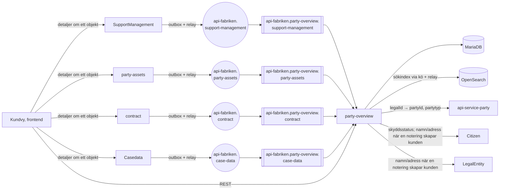
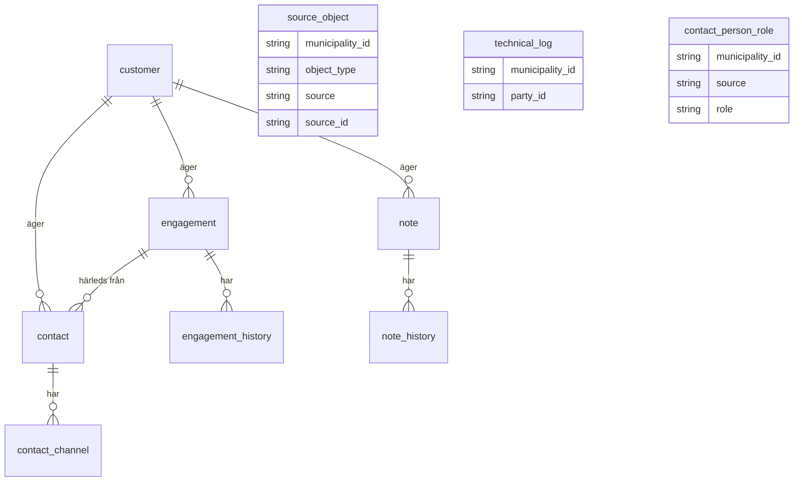

# party-overview — arkitektur för kundtjänsten (CRM)

party-overview håller en lättviktig bild av kommunens kunder, privatpersoner och företag, och deras engagemang i
kommunen: ärenden, tillgångar (assets), kontrakt och noteringar. Tjänsten lagrar referenser och envelope-data. Den som
vill se detaljer om ett objekt anropar källsystemet. Data kommer in asynkront via RabbitMQ och läses ut via REST.

Dokumentet beskriver lösningen i party-overview och de ändringar som publicerarna (SupportManagement, party-assets och
contract) behöver göra. All utveckling ska utgå från det. §14 delar upp arbetet i uppgifter med acceptanskriterier som
kan klistras in i Jira.

**Status:** fastställd design, version 1.1 (2026-11-24). Det gemensamma meddelandeformatet definieras senare. §3.1
listar de krav party-overview ställer på det.

---

## Innehåll

0. [Beslutslogg](#0-beslutslogg)
1. [Översikt](#1-översikt)
2. [Principer och regler](#2-principer-och-regler)
3. [Meddelanden](#3-meddelanden)
4. [Datamodell](#4-datamodell)
5. [Synlighet, kunddata och kontaktpersoner](#5-synlighet-kunddata-och-kontaktpersoner)
6. [REST-API](#6-rest-api)
7. [Integrationer](#7-integrationer)
8. [Teknisk logg och radering](#8-teknisk-logg-och-radering)
9. [Kodstruktur och konventioner](#9-kodstruktur-och-konventioner)
10. [Teststrategi](#10-teststrategi)
11. [Publicerarna](#11-publicerarna)
12. [Drift och konfiguration](#12-drift-och-konfiguration)
13. [Risker och öppna frågor](#13-risker-och-öppna-frågor)
14. [Uppgifter att bygga](#14-uppgifter-att-bygga)

---

## 0. Beslutslogg

| #  | Beslut | Valdes bort | Skäl |
|----|--------|-------------|------|
| 1  | Tjänsten behåller namnet party-overview: repot `api-service-party-overview`, paketet `se.sundsvall.partyoverview` och köerna `api-fabriken.party-overview.<källa>`. | Byta namn till crm. | Repot och namnet finns redan, så ett namnbyte vore bara kostnad. |
| 2  | POC-koden skrotas och `V1_0__create_tables.sql` skrivs om från grunden. | En `V1_1` som tar bort POC-tabellerna. | V1_0 har aldrig körts mot någon miljö. |
| 3  | Källsystemen är master för engagemang och kunddata. party-overview lagrar envelope-data men aldrig meddelandets payload. | Att lagra hela payloaden, som POC:en gör. | Tjänsten ska vara lättviktig, och en payload kan innehålla personuppgifter som inte behövs. |
| 4  | Kunddata (namn, adress, kontaktuppgifter och kontaktpersoner) kommer från meddelanden och går bara att läsa via REST. | Att party-overview är master för kunddata. | Källsystemen har redan datan, och det ska bara finnas en skrivväg. |
| 5  | Noteringar ägs av party-overview och skapas, ändras och raderas via REST. En notering hör alltid till ett namespace, och det finns inga globala noteringar. | Noteringar från källsystem. | Noteringar är kundvyns egna anteckningar, och kravet är att en verksamhet bara ser sina egna. |
| 6  | En notering på en kund som inte finns skapar kunden. Party avgör partytypen, och Citizen eller LegalEntity ger namn och adress. | Att svara 404 för okända kunder. | Handläggaren ska kunna anteckna om en kund som inget källsystem har nämnt än. |
| 7  | Engagemang syns för alla verksamheter i kommunen, med namespace som valfritt filter. Kontaktuppgifter syns för det egna namespacet plus de globala. Noteringar syns bara för det egna namespacet. | Att begränsa engagemang till eget namespace, eller att göra synligheten konfigurerbar. | Kundvyn ska ge helheten. Det som är känsligt stoppas redan hos publiceraren (beslut 19). |
| 8  | Ett engagemang lagras som en rad per kund. Ett ärende med tre kunder blir alltså tre rader. | En delad rad med kopplingstabell. | Det är det enda alternativet där `DELETE FROM customer` direkt i databasen tar med allt och inte lämnar föräldralösa rader med personuppgifter. Det som dupliceras är bara envelope-data. |
| 9  | En gemensam tabell, `engagement`, med en typkolumn för ärenden, assets och kontrakt. | En tabell per typ. | Typerna har samma envelope, och kundvyns lista sorterad på "senast ändrad" blir en enda indexerad fråga i stället för en UNION. |
| 10 | Historiken ligger i en tabell per förälder, `engagement_history` och `note_history`, med FK och `on delete cascade`. | En gemensam polymorf tabell. | En polymorf tabell kan inte ha FK, och då försvinner kaskaden. |
| 11 | Den tekniska loggen har ingen FK till kunden. Den finns kvar efter en kundradering och sparas tills den raderas manuellt via REST (§8.2). | Mjukradering, att loggen kaskadraderas med kunden, eller automatisk gallring. | Loggen ska kunna visa att kunden raderades. Beställaren vill behålla loggen tills någon aktivt raderar den. |
| 12 | Versionsvakten ligger i ett register per källobjekt, `source_object`, som saknar koppling till kunder och persondata. En DELETE lämnar en tombstone, och en senare UPDATE med högre version väcker objektet till liv igen. Tombstones sparas för alltid. | En vakt på engagemangsraderna, ett register över message-id, eller gallring av tombstones. | När objektet är raderat finns inga engagemangsrader kvar att jämföra mot, och en gammal UPDATE från en grundladdning skulle då väcka det till liv. Tombstones innehåller inga personuppgifter. |
| 13 | Samtidighet hanteras med radlås på `source_object` och kunder (IODKU + `SELECT … FOR UPDATE`, kunderna i partyId-ordning), plus `x-single-active-consumer` på varje kö. | Att lita enbart på single-active-consumer, som POC:en gör. | Flera köer och REST kan skriva till samma kund. Single-active-consumer behövs ändå för att objektets historik ska komma i rätt ordning. |
| 14 | En kund raderas av ett CUSTOMER DELETE-meddelande, av REST DELETE eller automatiskt när kunden saknar både engagemang och noteringar. | — | Beställarens krav. |
| 15 | party-overview härleder kontaktpersoner. En part med kontaktpersonsroll blir kontaktperson på objektets företagskunder men blir aldrig själv kund. Vilka roller som räknas som kontaktpersonsroller konfigureras per kommun och källa via REST. | Att publiceraren kopplar ihop dem, eller en lista i `application.yml`. | Beställarens val. I SM är rollerna metadata per namespace, så nya roller ska inte kräva en deploy. |
| 16 | Publicerarna skickar partyId när de har det. Det som ändå kommer som personnummer eller organisationsnummer mappar party-overview till partyId via api-service-party. Sådana nummer lagras och loggas aldrig. En part som Party inte hittar hoppas över. | Att bara party-overview mappar, eller att bara publicerarna gör det. | Personnummer ska färdas över köerna så sällan som möjligt, men kravtexten gäller fortfarande. Ett 404 från Party blir inte bättre av omförsök. |
| 17 | En lyssnare och en mappning hanterar alla köer. Källan bestäms av kön, inte av något i meddelandet. | Ett paket och en översättare per källa, som i POC:en. | Det gemensamma formatet gör översättarna onödiga. Kön kan dessutom bara nås via källans egen exchange. |
| 18 | Historiken byggs bara av de aktiviteter meddelandet bär (vad som hände och vem som gjorde det). Ett meddelande från en grundladdning bär inga aktiviteter. | Att party-overview själv härleder CREATED och UPDATED. | Bara källan vet vad som hände och vem som gjorde det. |
| 19 | SupportManagement publicerar bara ärenden från namespaces som har slagit på det i `namespace_config`. | Att alltid publicera, eller att publicera utan titel. | SM har åtkomstkontroll per namespace, och party-overview får inte kringgå den. |
| 20 | Varje publicerare har en transaktionell outbox och en relay som körs direkt efter commit och dessutom schemalagt med ShedLock. Grundladdningen går genom samma outbox. | En gemensam outbox i dept44, eller att publicera efter commit utan outbox. | Inga meddelanden får tappas, och mönstret finns redan i SM. |
| 21 | Namn och adress följer regeln "nyast vinner", mätt på källans `sourceModified`. | Att den som skrev senast vinner. | Ordningen blir deterministisk oavsett i vilken ordning meddelandena kommer, även vid grundladdning. |
| 22 | Kontaktuppgifter lagras per engagemang och ersätts som helhet varje gång ett meddelande appliceras. Dubbletter slås ihop vid läsning. | Ett separat kontaktregister per kund. | Uppgifterna följer källobjektet och försvinner med det. Det finns aldrig några inaktuella kontaktuppgifter att städa bort. |
| 23 | contract och party-assets publicerar utan namespace. Deras engagemang och kontaktuppgifter blir därmed globala. | Ett fast namespace per publicerare. | Ingen av källorna har namespace, och beställaren valde förslaget. |
| 24 | party-overview kan slå upp en kund på personnummer eller organisationsnummer via `POST …/customers/lookup`, med numret i kroppen. Numret mappas till partyId via Party och kastas sedan. | Att bara ta emot partyId. | Tredjepartstjänster som anropar party-overview har inte alltid partyId. Numret ska inte ligga i URL:en. |
| 25 | Kunder kan sökas med fritext via OpenSearch, med Hibernate Search som i SupportManagement (§6.2). Hibernate Search sköter mappning, schema, fråge-DSL och MassIndexer, men dess automatiska lyssnare är avstängda. I stället markeras kunder för indexering i tabellen `search_index_queue` i samma transaktion som ändringen, och en relay skriver till indexet. | SM:s asynkrona lyssnare med nattlig reindexering, eller opensearch-java utan Hibernate Search. | Lyssnarna ser varken IODKU, bulk-delete eller databasens kaskad. Asynkron indexering utan kö kan tappa ändringar. Kön ger leveransgaranti och slår ihop ändringar per kund, vilket behövs vid grundladdning. |
| 25a | Ingen databastrigger fångar raderingar för sökindexet. Tjänsten markerar sina egna raderingar. En kund som raderas direkt i databasen filtreras bort ur sökträffarna och försvinner ur indexet vid nästa reindexering. | En `after delete`-trigger på `customer`. | En trigger kräver särskilda databasrättigheter och syns inte i `schema.sql`. Att radera direkt i databasen är en manuell undantagsåtgärd. |
| 25b | Sökfrågan är `simple_query_string` med AND, och klienten får inte använda full Lucene-syntax. Kontaktuppgifter indexeras i ett fält per namespace (`contacts_ns_<namespace>`) och i ett globalt fält, inte som `nested`. | SM:s fulla Lucene-syntax och `nested`-dokument. | Full syntax kostade SM ett 40-tal rättelser. Med ett fält per namespace blir synligheten en del av frågan, och AND fungerar över namn och kontaktuppgifter. |
| 26 | SupportManagement publicerar inte utkast (`lifecycle = DRAFT`). | Att publicera utkast. | Ett utkast är inget engagemang än. |
| 27 | Skyddad identitet (§5.4) är en egenskap på kunden med tre nivåer: `NONE`, `SECRECY_MARKING` och `PROTECTED_REGISTRATION`. Den effektiva nivån är den högsta av folkbokföringens (Citizen), CUSTOMER-meddelandenas och engagemangsmeddelandenas. Är kunden skyddad lagras varken namn, adress eller kundens egna kontaktuppgifter, och de indexeras inte för sökning. | Att lagra uppgifterna och bara dölja dem i API:et, eller att bara lita på publicerarnas flagga. | Skatteverkets och eSams vägledning: namn, adress, telefon och e-post är skyddsvärda, man ska inte hämta eller spara mer än nödvändigt, och skyddet ska hållas uppdaterat från folkbokföringens flaggor. SPAR gör likadant och tar bort namn och adress. |
| 28 | Folkbokföringens skyddsstatus hämtas från Citizen (`ShowClassified=true`) när en privatkund skapas, och dessutom för alla privatkunder varje natt. | Att bara kontrollera vid skapandet, eller att bara lita på meddelandena. | Skyddet kan tillkomma eller upphöra när som helst, och vägledningen kräver att uppgifterna hålls uppdaterade. |
| 29 | Den tekniska loggen raderas inte automatiskt när en kund raderas på begäran enligt GDPR. Den kan raderas manuellt (§8.2). | Att radera loggen direkt. | partyId är ett pseudonymt id, och loggen innehåller inga andra personuppgifter. |
| 30 | De administrativa endpoints (kundradering, teknisk logg och kontaktpersonsroller) ligger i samma API som resten. | En egen API-produkt i gatewayen. | API:et är internt, och användarna är förvaltningen själv. |
| 31 | Dead letter-köerna har ingen TTL, och drift och utvecklare har åtkomst. En health-indikator i party-overview blir `DOWN` när någon av dem innehåller meddelanden, och Spring Boot Admin larmar då till Slack (§12.1). | TTL på köerna, eller larm i brokerns egen övervakning. | Inget meddelande får försvinna utan att någon har tittat på det. Spring Boot Admin med Slack-notifiering används redan. |
| 32 | Organisationsnummer skickas i URL:en mot Party, eftersom Party saknar batch för `ENTERPRISE`. | Att beställa en POST-endpoint i Party. | Det är befintlig funktionalitet och accepterat. |
| 33 | Kontaktpersonsrollerna sätts till `CONTACT_PERSON` för SupportManagement, contract och Casedata via REST vid driftsättning. | Att lägga in startvärdena i en Flyway-migrering. | Migreringarna ska vara oberoende av kommun. |
| 34 | Casedata blir en publicerare av `ERRAND` med källan `CASE_DATA` (§11.5). Ärenden med `confidential = true` publiceras som `DELETE`. | Att publicera sekretessmarkerade ärenden. | Beställaren räknar Casedata som ärendekälla. Ett ärende markerat som sekretess ska inte synas för hela kommunen. |
| 35 | Läsningar av skyddade kunder loggas inte särskilt i version 1. | En egen åtkomstlogg. | party-overview lagrar inga namn, adresser eller kontaktuppgifter för skyddade kunder. |
| 36 | En notering kan bara skapas med partyId. En tjänst som bara har personnummer hämtar partyId från Party först. | Att skapa en notering direkt med personnummer. | Beställarens val. |
| 37 | Casedata publicerar bara namespacet `SBK_MEX` tills dataskyddsombudet har tagit ställning till parkeringstillstånd och färdtjänst. Kontaktpersonsrollen för `CASE_DATA` är bara `CONTACT_PERSON`. | Att publicera alla namespaces från början. | Parkeringstillstånd och färdtjänst kan avslöja hälsorelaterade förhållanden. |
| 38 | party-overview får en egen OpenSearch-container per miljö i väntan på ett riktigt kluster, som SupportManagement har. Indexnamnet `customer` behöver därför inget miljöprefix. | Att dela kluster med SupportManagement. | Indexet byggs alltid om från databasen, så en enkel container räcker tills klustret finns. |
| 39 | I princip allt om kunden är sökbart: namn, adress, kontaktuppgifter och kontaktpersoner, engagemangens referens, titel och kategori, samt det egna namespacets noteringar. För en skyddad kund är bara engagemangens referenser sökbara (§6.2). | Att bara söka på namn, adress och kontaktuppgifter. | Beställarens krav. En referens som ärendenummer avslöjar inget om en skyddad person, men fritext i titlar och noteringar kan göra det. |
| 40 | Sökindexets relay körs direkt efter varje commit som markerar kunder, och dessutom var 10:e sekund som skyddsnät. En ändring blir sökbar inom någon sekund. | Bara schemalagd körning. | Med OpenSearch som eget system kan indexeringen inte ingå i databasens transaktion utan att meddelandeflödet blir beroende av OpenSearch och håller lås medan det väntar. Med körning direkt efter commit blir fördröjningen ändå kort. |
| 41 | `classified = "J"` i Citizen tolkas som sekretessmarkering, och `protectedNR = "J"` som skyddad folkbokföring. | Den omvända tolkningen, som api-service-caremanagement har i sin javadoc. | "NR" betyder folkbokföring (jämför fältet `nrDate`), och Citizen-dokumentationen skiljer på sekretessmarkerade personer och personer med skyddad folkbokföring. Det verifieras mot testpersoner i C3. |

---

## 1. Översikt



| Del | Ansvar |
|-----|--------|
| Publicerare | Äger sina objekt. Varje ändring publiceras som hela objektets tillstånd (`UPDATE`) eller som `DELETE`. Kan publicera om allt (grundladdning). |
| RabbitMQ | En exchange per publicerare och en kö per källa för party-overview. Varje kö har en dead letter-kö. Topologin deklareras i rabbitmq-topology. |
| party-overview | Gör upsert av kunder och engagemang, för historik och teknisk logg, äger noteringarna och exponerar kundvyn via REST. |
| OpenSearch | Sökindex för fritextsökning bland kunderna. MariaDB är master, och indexet kan alltid byggas om därifrån. |
| Frontend | Bygger kundvyn från party-overview och hämtar detaljer om ett objekt från källsystemet med `source` och `sourceId`. |

---

## 2. Principer och regler

1. **Envelope-data, inte detaljer.** party-overview lagrar det som behövs för att lista och känna igen ett objekt: id i
   källsystemet, referens, typ, titel, status, datum, namespace och parter. Allt annat hämtas från källan.
2. **Inga personnummer eller organisationsnummer.** De lagras inte i någon tabell, skrivs inte till någon logg och
   hamnar inte i något undantagsmeddelande. Även partyId räknas som personuppgift i applikationsloggar, enligt
   `dept44/docs/pii-logging-policy.md`.
3. **Källan är master.** Meddelanden innehåller alltid hela tillståndet, och party-overview gör upsert. Det enda
   party-overview själv äger är noteringarna och konfigurationen av kontaktpersonsroller.
4. **Allt som hör till en kund raderas med kunden.** Det gäller både via JPA och via `DELETE FROM customer` direkt i
   databasen, eftersom varje FK under `customer` har `on delete cascade`. Undantaget är den tekniska loggen och
   versionsregistret, som saknar FK och inte innehåller några kunduppgifter (§4.3).
5. **Spårbarhet.** Alla tabeller har `created`, och de tabeller som uppdateras har även `modified`. Rader som skrivs
   via REST har `created_by`/`modified_by`. Engagemang, kontakter och versionsregistret har id:t på meddelandet som
   senast skrev dem. Varje ändring av en kund, vare sig den kom via meddelande eller REST, syns i den tekniska loggen.
6. **Skyddad identitet går före allt annat.** För en kund med skyddade personuppgifter lagras inga namn, adresser
   eller egna kontaktuppgifter, och kunden går bara att hitta på referenser som ärendenummer. Skyddet visas på kunden i
   varje svar (§5.4).
7. **Ingen över-engineering.** Det finns en lyssnare för alla köer, en tabell för alla engagemangstyper och inga
   generiska ramverk. Kod, kommentarer och javadoc beskriver vad koden gör, inte hur den kom till.

---

## 3. Meddelanden

### 3.1 Krav på det gemensamma formatet

Formatet bygger på AsyncAPI och fastställs separat. party-overview kräver följande. Ett fält markerat **krav** saknas
inte i ett giltigt meddelande, och ett meddelande som bryter mot kraven dead-letteras direkt.

**AMQP-egenskaper**

| Egenskap | Krav |
|----------|------|
| `message-id` | **krav**, UUID. Samma meddelande får samma id om det skickas igen, medan en grundladdning ger nya id:n. |
| `content-type` | `application/json` |
| `x-request-id` | Sätts av dept44-starter-rabbitmq och lagras i den tekniska loggen. |
| Routing key | `<objektTyp>.<operation>` med gemener, t.ex. `errand.update` eller `customer.delete`. |

**Kropp**

| Fält | Typ | Krav | Beskrivning |
|------|-----|------|-------------|
| `operation` | `UPDATE` \| `DELETE` | **krav** | `UPDATE` innebär hela tillståndet och används även vid grundladdning. |
| `objectType` | `ERRAND` \| `ASSET` \| `CONTRACT` \| `CUSTOMER` | **krav** | |
| `municipalityId` | sträng | **krav** | Valideras med `@ValidMunicipalityId`. |
| `namespace` | sträng | valfri | Valideras med `@ValidNamespace`. Saknas den räknas objektet och dess kontaktuppgifter som globala. |
| `sourceId` | sträng | **krav** utom för `CUSTOMER` | Objektets id i källan, aldrig ett personnummer. |
| `version` | heltal (long) | **krav** | Ökar vid varje publicerad ändring av objektet. En `DELETE` bär minst den senaste versionen. |
| `sourceModified` | tidpunkt med zon | **krav** vid `UPDATE` | När objektet senast ändrades i källan. Sorteringsnyckel och mått för "nyast vinner". |
| `activities[]` | lista | valfri | Det som hände i den här ändringen. Listan är tom vid grundladdning. |
| `activities[].type` | sträng | **krav** | T.ex. `CREATED`, `UPDATED`, `STATUS_CHANGED`. Källan bestämmer värdena. |
| `activities[].description` | sträng ≤ 1024 | valfri | Kort text utan personuppgifter. |
| `activities[].performedBy.type` | sträng | valfri | T.ex. `AD_ACCOUNT`, `PARTY_ID` eller `SYSTEM`. |
| `activities[].performedBy.value` | sträng | valfri | Den som utförde ändringen, från `X-Sent-By` i källan. |
| `activities[].occurredAt` | tidpunkt med zon | **krav** | |
| `object.reference` | sträng | valfri | Visningsid, t.ex. ärendenummer, `assetId` eller `contractId`. |
| `object.title` | sträng | valfri | |
| `object.category` | sträng | valfri | Typ eller klassificering i källan. |
| `object.status` | sträng | valfri | Källans statuskod. Frontend översätter den. |
| `object.validFrom`, `object.validTo` | datum | valfri | |
| `object.sourceCreated` | tidpunkt med zon | valfri | |
| `parties[]` | lista | **krav** vid `UPDATE` (kan vara tom) | Objektets parter. För `CUSTOMER` exakt en. |
| `parties[].partyId` | UUID | partyId eller legalId | Bör alltid skickas när publiceraren har det. |
| `parties[].legalId` | sträng | partyId eller legalId | Personnummer eller organisationsnummer. Används bara när partyId saknas, och party-overview mappar det och kastar det sedan. |
| `parties[].partyType` | `PRIVATE` \| `ENTERPRISE` | **krav** | |
| `parties[].roles[]` | strängar | valfri | Källans rollkoder. |
| `parties[].name` | sträng | valfri | Visningsnamn: för- och efternamn, eller organisationsnamn. |
| `parties[].address` | objekt | valfri | `careOf`, `street`, `postalCode`, `city`, `country`. |
| `parties[].contactChannels[]` | lista | valfri | `type` (t.ex. `EMAIL`, `PHONE`) och `value`. |
| `parties[].protection` | `SECRECY_MARKING` \| `PROTECTED_REGISTRATION` | valfri | Sätts när källan vet att parten har skyddade personuppgifter. Då skickas varken `name`, `address` eller `contactChannels`. |

En part som saknar både partyId och legalId kan bara bli kontaktperson (§5.3). Annars ignoreras den.

Exempel:

```json
{
  "operation": "UPDATE",
  "objectType": "ERRAND",
  "municipalityId": "2281",
  "namespace": "CONTACTCENTER",
  "sourceId": "f0882f1d-06bc-47fd-b017-1d8307f5ce95",
  "version": 12,
  "sourceModified": "2026-11-20T10:15:30.123+01:00",
  "activities": [
    {
      "type": "STATUS_CHANGED",
      "description": "Status ändrad till ONGOING",
      "performedBy": { "type": "AD_ACCOUNT", "value": "joe01doe" },
      "occurredAt": "2026-11-20T10:15:30.123+01:00"
    }
  ],
  "object": {
    "reference": "KC-26110001",
    "title": "Fråga om bygglov",
    "category": "BUILDING_PERMIT",
    "status": "ONGOING",
    "sourceCreated": "2026-11-18T08:00:00.000+01:00"
  },
  "parties": [
    {
      "partyId": "8e2c9f0b-5a3d-4c11-9d0e-2f1b7a6c4d21",
      "partyType": "ENTERPRISE",
      "roles": ["APPLICANT"],
      "name": "Företaget AB",
      "address": { "street": "Storgatan 1", "postalCode": "85230", "city": "Sundsvall", "country": "Sverige" },
      "contactChannels": [{ "type": "EMAIL", "value": "info@foretaget.se" }]
    },
    {
      "partyType": "PRIVATE",
      "roles": ["CONTACT_PERSON"],
      "name": "Anna Andersson",
      "contactChannels": [{ "type": "PHONE", "value": "070-1234567" }]
    }
  ]
}
```

party-overview har en lokal kopia av formatets scheman i `src/main/resources/integrations/party-overview-messages.yaml`
och genererar sina modeller från den, som för alla andra integrationer.

### 3.2 Topologi

| Publicerare | Exchange | Kö för party-overview | Källa (`source`) |
|-------------|----------|------------------------|------------------|
| SupportManagement | `api-fabriken.support-management` | `api-fabriken.party-overview.support-management` | `SUPPORT_MANAGEMENT` |
| party-assets | `api-fabriken.party-assets` | `api-fabriken.party-overview.party-assets` | `PARTY_ASSETS` |
| contract | `api-fabriken.contract` | `api-fabriken.party-overview.contract` | `CONTRACT` |
| Casedata | `api-fabriken.case-data` | `api-fabriken.party-overview.case-data` | `CASE_DATA` |

Varje kö deklareras i rabbitmq-topology som en quorum-kö med följande:

- dead-letter-exchange och en egen dead letter-kö (`….dlq`)
- `x-delivery-limit: 5`
- `x-single-active-consumer: true`. Argumentet går inte att lägga till på en befintlig quorum-kö, så det måste finnas när kön skapas.
- bindning till publicerarens exchange med `#`. Kön tar emot alla objekttyper från källan.

Dead letter-köerna har ingen TTL, och ett meddelande ligger kvar tills någon har tagit hand om det. Köerna kan
innehålla personuppgifter, t.ex. ett legalId eller namn, och därför har bara drift och utvecklare åtkomst. Det larmas
när en dead letter-kö inte är tom (§12.1).

party-overview deklarerar ingen topologi själv, och dess AMQP-användare saknar configure-rättighet.

### 3.3 Flödet genom tjänsten

```
MessageListener (alla köer)                          ingen transaktion
  └─ MessageService.handle(source, messageId, message)
       1. mappa till ObjectChange och validera (@Validated)  ─ ogiltigt → dead letter direkt
       2. läs kontaktpersonsroller för (kommun, källa)
       3. dela upp parterna i kunder och kontaktpersoner (§5.3)
       4. legalId → partyId via PartyIntegration, bara för kundparter
                                                             ─ 404 → parten hoppas över (WARN utan PII)
          (en kontaktpersons legalId används inte och kastas)
       5. folkbokföringens skyddsstatus för PRIVATE-kundparter som inte finns i databasen
          (CitizenIntegration, batch, ShowClassified=true, §5.4)
       6. MessageWriter.apply(change)                         @Transactional, egen bean
            a. lås källobjektet (source_object: IODKU, sedan SELECT … FOR UPDATE)
            b. avgör enligt versionsmatrisen (§3.4)           ─ inaktuellt → bara teknisk logg
            c. lås kunderna (IODKU och FOR UPDATE, i partyId-ordning)
            d. tillämpa UPDATE eller DELETE (§3.5) och räkna om kundernas skyddsnivå (§5.4)
            e. skriv teknisk logg för varje berörd kund och markera kunden för sökindexering
               (search_index_queue, §6.2)
```

- Feign-anropen görs utanför transaktionen, så att en långsam Party inte håller lås i databasen.
- `MessageListener` tar källan ur headern `AmqpHeaders.CONSUMER_QUEUE` och slår upp den i konfigurationen
  `integration.sources` (§12).
- Native insert kör inte `@PrePersist`, så IODKU-satserna sätter själva `id`, `created` och `modified`.

### 3.4 Versionsmatrisen

`s` är versionen i `source_object`, och `v` är meddelandets version.

| Lagrat `source_object` | `UPDATE` med version v | `DELETE` med version v |
|------------------------|-------------------------|-------------------------|
| saknas | Tillämpa. Raden skapas med version v. | Spara en tombstone (`deleted = true`, version v). |
| aktivt, version s | `v < s`: inaktuellt.<br/>`v = s`: tillämpa som rättning, utan historik.<br/>`v > s`: tillämpa med historik. | `v < s`: inaktuellt.<br/>`v ≥ s`: radera objektets engagemang och markera raden som raderad. |
| raderat, version s | `v ≤ s`: inaktuellt.<br/>`v > s`: objektet väcks till liv. Tillämpa med historik. | `v ≤ s`: inaktuellt.<br/>`v > s`: höj versionen, inget mer. |

- Ett inaktuellt meddelande ändrar ingenting utom den tekniska loggen (`IGNORED_STALE`).
- Om samma meddelande levereras igen blir det en rättning med samma version, och därmed ingen dubblerad historik.
  Därför behövs inget register över message-id.
- En grundladdning medan publiceraren är i drift är ofarlig. En ögonblicksbild som är äldre än en DELETE stoppas av
  tombstonen.
- Raderade `source_object`-rader (tombstones) sparas för alltid. De innehåller inga personuppgifter.

### 3.5 Tillämpning

**UPDATE för `ERRAND`, `ASSET` och `CONTRACT`**

1. För varje kundpart (§5.3):
   - Skapa kunden om den saknas (`CUSTOMER_CREATED`). En ny privatkund får folkbokföringens skyddsstatus från steg 5 i
     §3.3.
2. Gör upsert av engagemangsraden per kund, nycklad på `(municipality_id, object_type, source, source_id, customer_id)`:
   - envelope-fälten, roller, namespace, `party_protection` (partens `protection`) och `last_message_id`
   - `ENGAGEMENT_CREATED` om raden är ny, annars `ENGAGEMENT_UPDATED`
3. Räkna om kundens skyddsnivå (§5.4). Om kunden är oskyddad uppdateras namn och adress enligt "nyast vinner" (§5.2) och
   radens kontaktuppgifter ersätts (§5.3). Om kunden är skyddad sparas inget av det.
4. Skriv meddelandets `activities` som historik på raden, men bara om raden är ny eller om `v > s`.
5. Radera engagemangsrader för kunder som inte längre är parter (`ENGAGEMENT_REMOVED`). Kontrollera sedan om kunden ska
   raderas automatiskt (§3.6), och räkna annars om dess skyddsnivå.
6. Sätt `source_object.version = v`, `deleted = false` och `last_message_id`.

En kund som förekommer flera gånger i `parties` blir en enda rad, och rollerna slås ihop.

**DELETE för `ERRAND`, `ASSET` och `CONTRACT`**

Radera objektets alla engagemangsrader (`ENGAGEMENT_REMOVED` för varje kund). Kontrollera sedan om kunden ska raderas
automatiskt, räkna annars om dess skyddsnivå, och markera `source_object` som raderat med version v.

**UPDATE för `CUSTOMER`**

- Skapa kunden om den saknas.
- Sätt `asserted_protection` till partens `protection` och räkna om skyddsnivån (§5.4).
- Om kunden är oskyddad:
  - Uppdatera namn och adress enligt "nyast vinner".
  - Ersätt kundens kontaktuppgifter från den här källan (rader med `engagement_id is null` och samma `source`). De får
    meddelandets namespace, och saknas det blir de globala.
- Logga `CUSTOMER_UPDATED`.

Versionsvakten nycklas på kundens partyId, efter en eventuell mappning från legalId.

**DELETE för `CUSTOMER`**

Radera kunden med allt den äger (§3.6) och logga `CUSTOMER_DELETED`.

### 3.6 Kundradering

En kund raderas i tre fall:

| Orsak | Kanal i loggen | Objekttyp i loggen |
|-------|----------------|--------------------|
| Ett `CUSTOMER DELETE`-meddelande | `MESSAGE` | `CUSTOMER` |
| `DELETE /{municipalityId}/customers/{partyId}` | `REST` | — |
| Sista engagemanget är borta och kunden har inga noteringar | `MESSAGE` | det objekt som tog bort engagemanget |

- Raderingen görs som en bulk-delete (`@Modifying(flushAutomatically = true, clearAutomatically = true)`).
  Databasens kaskad tar resten. Hibernate får alltså inte ha barnrader laddade som det sedan försöker skriva tillbaka.
- Den tekniska loggraden `CUSTOMER_DELETED` skrivs i samma transaktion som raderingen.
- Ett senare meddelande som nämner kunden skapar den på nytt. Det är avsiktligt, eftersom källsystemet är master.
- En kund som bara har kontaktuppgifter från `CUSTOMER`-meddelanden, och varken engagemang eller noteringar, raderas
  inte automatiskt. Kontrollen görs bara när ett engagemang tas bort.

### 3.7 Felhantering

Fel klassas av dept44-starter-rabbitmq (`TransientFailures`):

| Fel | Följd |
|-----|-------|
| Valideringsfel (`ConstraintViolationException`), okänd objekttyp, saknad version | Dead letter direkt |
| Party svarar 404 på ett legalId | Parten hoppas över och resten av meddelandet tillämpas. WARN loggas med källa och `sourceId`, men utan legalId. |
| 5xx från Party (`ServerProblem`) | Omförsök i cirka 8 minuter, sedan dead letter |
| Databasen svarar inte, öppen circuit breaker | Avbrott: omförsök, sedan tillbaka till kön, räknas mot `x-delivery-limit` |
| Deadlock eller lock timeout (`TransientDataAccessException`) | Omförsök |
| `DataIntegrityViolationException` | Dead letter direkt. Ska inte kunna inträffa tack vare IODKU, så det är en bugg om det händer. |

Ett meddelande som misslyckas rullas tillbaka helt och syns inte i den tekniska loggen. Det syns i starterns WARN-rad
och i dead letter-kön.

---

## 4. Datamodell

### 4.1 Översikt



`source_object`, `technical_log`, `contact_person_role`, `search_index_queue` och `shedlock` står fristående, utan FK.

### 4.2 Gemensamt för alla tabeller

- `id varchar(36)`, UUID från `@UuidGenerator`.
- `municipality_id varchar(8)` och `namespace varchar(32)`. Kommun-id finns även på barnrader, så att man kan filtrera
  utan join.
- Tidsstämplar är `datetime(6)` med `@TimeZoneStorage(NORMALIZE)`, sätts i `@PrePersist`/`@PreUpdate` och trunkeras
  till millisekunder.
- Varje FK under `customer` har `on delete cascade`. I entiteterna motsvaras det av `@ManyToOne(fetch = LAZY)`,
  `@ForeignKey(name = …)` och `@OnDelete(action = CASCADE)` på barnet, medan föräldern inte har någon kollektion. På
  `@ElementCollection` sitter `@OnDelete` på kollektionen. Om Hibernate inte genererar kaskaden för kollektionstabellen,
  vilket `schema.sql` visar, modelleras `contact_channel` i stället som en entitet med `@ManyToOne`.
- Index, unika nycklar och FK har samma namn i `@Table`/`@ForeignKey` och i Flyway: `uq_<tabell>_<kolumner>`,
  `idx_<tabell>_<kolumner>` och `fk_<tabell>_<kolumn>`.
- Enum-kolumner lagras som `varchar` och har inga check-constraints, så att ett nytt värde inte kräver en migrering.

### 4.3 Tabellerna

**`customer`**: en kund per kommun och partyId.

| Kolumn | Typ | Null | Anmärkning |
|--------|-----|------|------------|
| `id` | varchar(36) | nej | PK |
| `municipality_id` | varchar(8) | nej | |
| `party_id` | varchar(36) | nej | |
| `party_type` | varchar(16) | nej | `PRIVATE` eller `ENTERPRISE` |
| `name` | varchar(255) | ja | Alltid null om kunden är skyddad |
| `care_of`, `street`, `postal_code`, `city`, `country` | varchar(255), postal_code varchar(16) | ja | Alltid null om kunden är skyddad |
| `profile_modified` | datetime(6) | ja | `sourceModified` för de namn- och adressuppgifter som är lagrade (§5.2) |
| `protection_level` | varchar(32) | nej | Effektiv nivå: `NONE`, `SECRECY_MARKING` eller `PROTECTED_REGISTRATION` (§5.4) |
| `registry_protection` | varchar(32) | ja | Folkbokföringens nivå enligt Citizen. Alltid null för `ENTERPRISE`. |
| `registry_checked` | datetime(6) | ja | När Citizen senast tillfrågades |
| `asserted_protection` | varchar(32) | ja | Nivån från det senast tillämpade `CUSTOMER`-meddelandet |
| `created`, `modified` | datetime(6) | nej/ja | |

Index:

- `uq_customer_municipality_id_party_id (municipality_id, party_id)`
- `idx_customer_party_type_registry_checked`: urvalet till den nattliga kontrollen av skyddsstatus

**`engagement`**: ett källobjekt sett från en kund (beslut 8).

| Kolumn | Typ | Null | Anmärkning |
|--------|-----|------|------------|
| `id` | varchar(36) | nej | PK |
| `customer_id` | varchar(36) | nej | FK `fk_engagement_customer_id`, cascade |
| `municipality_id` | varchar(8) | nej | |
| `namespace` | varchar(32) | ja | null betyder globalt |
| `object_type` | varchar(32) | nej | `ERRAND`, `ASSET` eller `CONTRACT` |
| `source` | varchar(64) | nej | `SUPPORT_MANAGEMENT`, `PARTY_ASSETS` eller `CONTRACT` |
| `source_id` | varchar(255) | nej | |
| `reference`, `title`, `category` | varchar(255) | ja | |
| `status` | varchar(64) | ja | |
| `roles` | varchar(255) | ja | Kundens roller, sorterade och kommaseparerade (`AttributeConverter`) |
| `party_protection` | varchar(32) | ja | Skyddsnivån som källan angav för kunden i det här objektet |
| `valid_from`, `valid_to` | date | ja | |
| `source_created` | datetime(6) | ja | |
| `source_modified` | datetime(6) | nej | Sorteringsnyckel. `modified` ändras av varje grundladdning och duger inte till det. |
| `last_message_id` | varchar(36) | nej | |
| `created`, `modified` | datetime(6) | nej/ja | |

Index:

- `uq_engagement_municipality_id_object_type_source_source_id_customer_id`. Prefixet används också för att hitta alla
  rader för ett källobjekt. Nyckeln är cirka 1,6 kB och ryms inom InnoDB:s gräns på 3072 byte.
- `idx_engagement_customer_id_source_modified`: kundvyns lista, och kontrollen om kunden har engagemang kvar.
- `idx_engagement_customer_id_object_type_source_modified`: listan filtrerad på typ.

**`engagement_history`**: aktiviteter från meddelandena (beslut 18).

| Kolumn | Typ | Null | Anmärkning |
|--------|-----|------|------------|
| `id` | varchar(36) | nej | PK |
| `engagement_id` | varchar(36) | nej | FK `fk_engagement_history_engagement_id`, cascade |
| `municipality_id` | varchar(8) | nej | |
| `type` | varchar(64) | nej | |
| `description` | varchar(1024) | ja | |
| `performed_by_type`, `performed_by` | varchar(32), varchar(255) | ja | |
| `occurred_at` | datetime(6) | nej | |
| `message_id` | varchar(36) | nej | |
| `created` | datetime(6) | nej | |

Index: `idx_engagement_history_engagement_id_occurred_at`.

**`contact`**: kontaktuppgifter som syns per namespace (§5.3).

| Kolumn | Typ | Null | Anmärkning |
|--------|-----|------|------------|
| `id` | varchar(36) | nej | PK |
| `customer_id` | varchar(36) | nej | FK `fk_contact_customer_id`, cascade |
| `engagement_id` | varchar(36) | ja | FK `fk_contact_engagement_id`, cascade. null betyder att uppgiften kommer från ett `CUSTOMER`-meddelande. |
| `municipality_id` | varchar(8) | nej | |
| `namespace` | varchar(32) | ja | null betyder globalt |
| `source` | varchar(64) | nej | |
| `contact_type` | varchar(32) | nej | `CUSTOMER` (kundens egna uppgifter) eller `CONTACT_PERSON` |
| `name` | varchar(255) | ja | Kontaktpersonens namn |
| `role` | varchar(64) | ja | Kontaktpersonens roll |
| `message_id` | varchar(36) | nej | |
| `created` | datetime(6) | nej | Raderna ersätts som helhet och uppdateras aldrig. |

Index: `idx_contact_customer_id_namespace` och `idx_contact_engagement_id`.

**`contact_channel`**: `@ElementCollection` på `contact`.

| Kolumn | Typ | Null |
|--------|-----|------|
| `contact_id` | varchar(36) | nej, FK `fk_contact_channel_contact_id`, cascade |
| `type` | varchar(32) | nej |
| `value` | varchar(255) | nej |

**`note`**

| Kolumn | Typ | Null | Anmärkning |
|--------|-----|------|------------|
| `id` | varchar(36) | nej | PK |
| `customer_id` | varchar(36) | nej | FK `fk_note_customer_id`, cascade |
| `municipality_id` | varchar(8) | nej | |
| `namespace` | varchar(32) | nej | |
| `subject` | varchar(255) | ja | |
| `body` | longtext | nej | |
| `created`, `created_by` | datetime(6), varchar(255) | nej | |
| `modified`, `modified_by` | datetime(6), varchar(255) | ja | |

Index: `idx_note_customer_id_namespace_created`.

**`note_history`**: samma kolumner som `engagement_history`, med `note_id` (FK `fk_note_history_note_id`, cascade) i
stället för `engagement_id`. `type` är `CREATED` eller `UPDATED`, `performed_by` kommer från `X-Sent-By` och
`message_id` saknas. De gemensamma kolumnerna ligger i en `@MappedSuperclass AbstractHistoryEntity`.

Index: `idx_note_history_note_id_occurred_at`.

**`source_object`**: versionsregistret (beslut 12). Tabellen har inga kunduppgifter och ingen FK.

| Kolumn | Typ | Null |
|--------|-----|------|
| `id` | varchar(36) | nej |
| `municipality_id` | varchar(8) | nej |
| `object_type` | varchar(32) | nej |
| `source` | varchar(64) | nej |
| `source_id` | varchar(255) | nej. För `CUSTOMER` är det kundens partyId. |
| `version` | bigint | nej |
| `deleted` | bit | nej |
| `last_message_id` | varchar(36) | nej |
| `created`, `modified` | datetime(6) | nej/ja |

Index: `uq_source_object_municipality_id_object_type_source_source_id`.

**`technical_log`**: den tekniska loggen (beslut 11, §8). Tabellen har ingen FK.

| Kolumn | Typ | Null | Anmärkning |
|--------|-----|------|------------|
| `id` | varchar(36) | nej | |
| `municipality_id` | varchar(8) | nej | |
| `party_id` | varchar(36) | nej | |
| `channel` | varchar(16) | nej | `MESSAGE`, `REST` eller `SCHEDULER` |
| `message_id`, `request_id` | varchar(36) | ja | |
| `source` | varchar(64) | ja | |
| `object_type` | varchar(32) | ja | |
| `source_id` | varchar(255) | ja | |
| `operation` | varchar(16) | ja | `UPDATE` eller `DELETE` |
| `source_version` | bigint | ja | |
| `outcome` | varchar(32) | nej | §8.1 |
| `performed_by` | varchar(255) | ja | Vid REST |
| `protection_level` | varchar(32) | ja | Den nya nivån vid `PROTECTION_CHANGED` |
| `created` | datetime(6) | nej | |

Index: `idx_technical_log_municipality_id_party_id_created` och `idx_technical_log_created`, som används vid manuell
radering på datum (§8.2).

**`contact_person_role`**: konfiguration (beslut 15).

| Kolumn | Typ | Null |
|--------|-----|------|
| `id` | varchar(36) | nej |
| `municipality_id` | varchar(8) | nej |
| `source` | varchar(64) | nej |
| `role` | varchar(64) | nej |
| `created`, `created_by` | datetime(6), varchar(255) | nej |

Index: `uq_contact_person_role_municipality_id_source_role`.

**`search_index_queue`**: kunder som ska indexeras om eller tas bort ur sökindexet (§6.2). Tabellen har ingen FK, så
att en raderad kund finns kvar i kön tills den har tagits bort ur indexet.

| Kolumn | Typ | Null | Anmärkning |
|--------|-----|------|------------|
| `customer_id` | varchar(36) | nej | PK. Flera markeringar av samma kund slås ihop. |
| `municipality_id` | varchar(8) | nej | |
| `version` | bigint | nej | Ökas vid varje ny markering |
| `attempts` | int | nej | Antal misslyckade försök, förval 0 |
| `queued` | datetime(6) | nej | |

Index: `idx_search_index_queue_queued`.

**`shedlock`**: standardtabellen för dept44-starter-scheduler.

### 4.4 Flyway

- Allt hamnar i en ny `V1_0__create_tables.sql` som ersätter POC:ns. Kommande ändringar blir `V1_<n>__<beskrivning>.sql`.
- FK skrivs med `on delete cascade` i Flyway och med `@OnDelete` i entiteterna. `src/test/resources/db/schema/schema.sql`
  genereras från entiteterna.
- IT-profilen kör Flyway och `schema-generation: validate`. Validate kontrollerar kolumner men inte index eller FK.
  Därför finns `SchemaParityIT` (§10).

---

## 5. Synlighet, kunddata och kontaktpersoner

### 5.1 Synlighet per namespace

| Data | Vad en verksamhet (`{namespace}` i sökvägen) ser |
|------|-------------------------------------------------|
| Kund (namn, adress, typ, skyddsnivå) | Allt. För en skyddad kund finns varken namn eller adress (§5.4). |
| Engagemang och deras historik | Alla i kommunen. Valfritt filter: `engagementNamespace`. |
| Kontaktuppgifter och kontaktpersoner | `namespace = {namespace}` eller `namespace is null` |
| Noteringar och deras historik | `namespace = {namespace}` |
| Teknisk logg | Ingen namespace-filtrering. Exponeras utan namespace i sökvägen (§6). |

Frågan för kontakter, `customer_id = ? and (namespace = ? or namespace is null)`, går via
`idx_contact_customer_id_namespace` (`ref_or_null`).

### 5.2 Namn och adress

- Namn och adress sätts från kundparten i varje tillämpat meddelande som har namn eller adress. Det gäller bara om
  `customer.profile_modified` är null eller ≤ meddelandets `sourceModified`. När det sker sätts `profile_modified` till
  `sourceModified`.
- Uppgifterna ersätts som helhet. Ett meddelande som har namn men saknar adress tömmer alltså adressen.
- En oskyddad kund som skapas av en notering får sina uppgifter från Citizen eller LegalEntity, med
  `profile_modified = now()` (§7.2).
- För en skyddad kund sparas inga namn- eller adressuppgifter alls (§5.4).

### 5.3 Kunder, kontaktpersoner och kontaktuppgifter

Varje part i ett meddelande sorteras så här:

| Parten har | Har en roll i `contact_person_role` för (kommun, källa) | Resultat |
|------------|---------------------------------------------------------|----------|
| partyId eller legalId som går att mappa | nej | **Kund**, med engagemang |
| vad som helst | ja | **Kontaktperson** på objektets alla `ENTERPRISE`-kunder. Blir aldrig själv kund. Har objektet ingen företagskund ignoreras parten. |
| varken partyId eller legalId | nej | Ignoreras |

För varje kunds engagemangsrad ersätts kontaktuppgifterna (`contact` med `engagement_id` = raden) med:

- en rad med `contact_type = CUSTOMER` med kundpartens egna `contactChannels`, om den har några, och
- om kunden är `ENTERPRISE`: en rad med `contact_type = CONTACT_PERSON` för varje kontaktperson, med namn, den roll som
  matchade och kontaktkanaler.

Alla rader får engagemangets namespace.

Vid läsning slås identiska kontakter ihop: samma typ, namn, roll och samma uppsättning kanaler. Det som ändrats senast
kommer först.

En ändring av kontaktpersonsrollerna gäller från nästa meddelande om varje objekt. Befintliga rader räknas om vid nästa
ändring i källan eller vid en grundladdning.

För en skyddad kund sparas ingen rad med `contact_type = CUSTOMER` (§5.4). Kontaktpersoner på företag påverkas inte,
eftersom skyddet gäller kunden och inte kontaktpersonen.

### 5.4 Skyddad identitet

**Underlag.** Designen följer Skatteverkets
[vägledning för offentliga aktörers hantering av skyddade personuppgifter](https://skatteverket.se/offentligaaktorer/folkbokforing/vagledningforoffentligaaktorershanteringavskyddadepersonuppgifter.4.18e1b10334ebe8bc80002541.html)
och eSams promemoria
[Skyddade personuppgifter – myndigheters hantering (ES2023-12)](https://www.esamverka.se/download/18.2d4111b018c3dd35ea14c00/1701955298915/ES2023-12%20Skyddade%20personuppgifter%20-%20myndigheters%20hantering.pdf).
Det som styr designen:

- **Skyddade personuppgifter** är två nivåer som Skatteverket beslutar om:
  - *sekretessmarkering*: en varningssignal om att en skadeprövning krävs innan uppgifterna lämnas ut
  - *skyddad folkbokföring*: den högre nivån, där den verkliga adressen inte finns i folkbokföringen

  I Navet visas sekretessmarkering med en flagga och skyddad folkbokföring med två. Systemen ska kunna skilja nivåerna
  åt.
- *Fingerade personuppgifter* beslutas av Polismyndigheten. Personen har då en annan, fullständig identitet, och den
  syns inte som skydd. party-overview hanterar dem inte särskilt.
- Inte bara adressen är skyddsvärd. Vägledningen räknar upp bland annat namn, adress, e-post, telefonnummer,
  arbetsgivare och skola. Det gäller även uppgifter som fanns innan personen fick skydd.
- Skyddet ska vara tydligt utmärkt i varje vy. Behörigheten ska vara begränsad, och man ska inte hämta eller spara fler
  uppgifter än nödvändigt.
- Skyddet kan tillkomma, ändras och upphöra. Uppgifterna ska hållas uppdaterade, och man bör undvika egna markeringar
  utöver folkbokföringens flaggor.
- SPAR tar bort namn och adress för personer med skydd och behåller bara personnumret och en flagga.
- En person kan ha ett skyddsbehov utan att vara markerad i folkbokföringen. Därför räknas också källsystemens uppgift
  om skydd.

**Nivåer och källor.** Kundens effektiva nivå, `customer.protection_level`, är den högsta av:

| Källa | Kolumn | Uppdateras |
|-------|--------|------------|
| Folkbokföringen via Citizen, bara för `PRIVATE` | `customer.registry_protection` | när kunden skapas, och varje natt |
| `CUSTOMER`-meddelanden | `customer.asserted_protection` | när ett `CUSTOMER UPDATE` tillämpas |
| Engagemangsmeddelanden | `engagement.party_protection` | när objektet uppdateras. Försvinner med engagemanget. |

Ordningen är `NONE` < `SECRECY_MARKING` < `PROTECTED_REGISTRATION`. Nivån räknas om i samma transaktion varje gång
någon av källorna ändras. En ändrad nivå loggas som `PROTECTION_CHANGED` i den tekniska loggen.

**Citizen.** Citizen svarar för personer både i och utanför kommunen. Personer som är sekretessmarkerade eller har
skyddad folkbokföring filtreras bort helt, om man inte frågar med `ShowClassified=true`.

- `ShowClassified=true` fungerar bara för en applikation i API-gatewayen (WSO2) som är behörig enligt en tabell i
  Metakatalogen. Annars svarar Citizen 401, oavsett vilken person man frågar efter.
- party-overviews applikation måste därför registreras i Metakatalogen innan meddelandeflödet och noteringarna slås
  på (§13.2).
- Flaggorna `classified` och `protectedNR` har värdet `"J"` när de är satta.

party-overview frågar alltid med `ShowClassified=true` och tolkar svaret så här (beslut 41):

| `protectedNR` | `classified` | `registry_protection` |
|---------------|--------------|-----------------------|
| `J` | valfritt | `PROTECTED_REGISTRATION` |
| inte `J` | `J` | `SECRECY_MARKING` |
| inte `J` | inte `J` | `NONE` |
| Citizen har ingen post (204) | | `NONE` |

Citizens dokumentation säger inte uttryckligen vilken flagga som betyder vad. Tolkningen bygger på namngivningen, och
den verifieras mot testpersoner i C3. En felaktig tolkning skulle bara ändra vilken nivå som visas, eftersom
hanteringen nedan är densamma för båda nivåerna.

Svaret från Citizen hålls bara i minnet. Namn och adress ur svaret används bara om personen är oskyddad, och ingenting
ur svaret loggas.

En privatkund kan ibland skapas utan känd skyddsstatus. Det händer om kunden fanns när statusen kontrollerades men hann
raderas innan meddelandet skrevs. Kunden får då `registry_checked = null`, och den behandlas som skyddad tills den
nattliga kontrollen har körts. Inga namn, adresser eller kontaktuppgifter sparas under tiden.

**Hantering när kunden är skyddad** (`protection_level ≠ NONE`):

1. `name`, adressfälten och `profile_modified` töms, och kundens rader med `contact_type = CUSTOMER` raderas. Så länge
   skyddet gäller sparas inga sådana uppgifter, varken från meddelanden, från Citizen eller från LegalEntity.
2. Kunden indexeras i OpenSearch bara med engagemangens referenser, utan namn, adress, kontaktuppgifter, titlar och
   noteringar. Den går därför bara att hitta på en referens, som ett ärendenummer, på partyId eller med uppslag på
   personnummer (§6).
3. API:et returnerar `protectionLevel` på kunden, och namn, adress och kontaktkanaler är tomma. Frontend ska visa
   skyddet tydligt i varje vy som rör kunden och skilja nivåerna åt.
4. Engagemang, historik och noteringar finns kvar. Envelope-data och noteringar ska inte innehålla skyddsvärda uppgifter.
   Det ansvaret ligger hos källsystemen och verksamheterna (§13).

**När skyddet upphör** fylls namn och adress i igen. För privatkunder sker det från Citizens svar i den nattliga
kontrollen. Kontaktuppgifter kommer tillbaka med nästa tillämpade meddelande från källan, eller vid en grundladdning.

**Nattlig kontroll.** `ProtectionRefreshScheduler` (`@Dept44Scheduled` med ShedLock) körs en gång per natt. Den hämtar
privatkunder vars `registry_checked` är äldre än `protection.refresh-age` (förval `P1D`). Kunderna tas i batchar om
`protection.batch-size` (förval 100) via `POST /{municipalityId}/batch?ShowClassified=true`. Varje batch skrivs i en
egen transaktion. Kunden låses och nivån räknas om, och sedan indexeras de ändrade kunderna.

---

## 6. REST-API

Alla sökvägar validerar med `@ValidMunicipalityId`, `@ValidNamespace` och `@ValidUuid`. Listor returneras som
`Page<T>` med `@ParameterObject Pageable`, och sidstorleken är högst 100. Fel returneras som Problem. Skrivningar
kräver `X-Sent-By`. `@ValidUuid` sätts inte på id-fält som är READ_ONLY.

### 6.1 Endpoints

| Metod och sökväg | Beskrivning | Svar |
|------------------|-------------|------|
| `GET /{municipalityId}/{namespace}/customers/{partyId}` | Kunden med de kontaktuppgifter och kontaktpersoner som syns för namespacet | 200, 404 |
| `POST /{municipalityId}/{namespace}/customers/lookup` | Slår upp en kund på personnummer eller organisationsnummer. Kropp: `legalId` och `partyType`. Numret mappas till partyId via Party (§7.1) och kastas sedan. Svaret är detsamma som för `GET` på kunden. | 200, 404 |
| `GET /{municipalityId}/{namespace}/customers/search` | Fritextsökning bland kunderna (§6.2) | 200, 400, 503, 504 |
| `POST /search/reindex` | Bygger om sökindexet från databasen, asynkront (§6.2) | 202, 409 |
| `GET /{municipalityId}/{namespace}/customers/{partyId}/engagements` | Engagemang. Filter `objectType` och `engagementNamespace`. Sorteras förvalt på `sourceModified,desc`. | 200, 404 |
| `GET /{municipalityId}/{namespace}/customers/{partyId}/engagements/{engagementId}` | Ett engagemang | 200, 404 |
| `GET /{municipalityId}/{namespace}/customers/{partyId}/engagements/{engagementId}/history` | Historik, förvalt `occurredAt,desc` | 200, 404 |
| `GET /{municipalityId}/{namespace}/customers/{partyId}/notes` | Namespacets noteringar, förvalt `created,desc` | 200, 404 |
| `POST /{municipalityId}/{namespace}/customers/{partyId}/notes` | Skapar en notering och vid behov kunden (§7.2) | 201 med Location, 404 om parten är okänd |
| `GET /{municipalityId}/{namespace}/customers/{partyId}/notes/{noteId}` | En notering | 200, 404 |
| `PATCH /{municipalityId}/{namespace}/customers/{partyId}/notes/{noteId}` | Ändrar `subject` eller `body` | 200, 404 |
| `DELETE /{municipalityId}/{namespace}/customers/{partyId}/notes/{noteId}` | Raderar noteringen och dess historik | 204, 404 |
| `GET /{municipalityId}/{namespace}/customers/{partyId}/notes/{noteId}/history` | Noteringens historik | 200, 404 |
| `DELETE /{municipalityId}/customers/{partyId}` | Raderar kunden med allt den äger och loggar `CUSTOMER_DELETED` | 204, 404 |
| `GET /{municipalityId}/customers/{partyId}/technical-log` | Den tekniska loggen, förvalt `created,desc`. Fungerar även efter radering. | 200 |
| `DELETE /{municipalityId}/technical-log?partyId=&createdBefore=` | Raderar rader i den tekniska loggen. Minst ett av filtren krävs, och båda kan kombineras (§8.2). | 204, 400 |
| `GET /{municipalityId}/contact-person-roles` | Kontaktpersonsroller per källa | 200 |
| `PUT /{municipalityId}/contact-person-roles/{source}` | Ersätter källans roller (kropp: lista med roller). En okänd källa ger 400. | 204, 400 |

- En notering eller ett engagemang som inte tillhör kunden i sökvägen, eller en notering i ett annat namespace, ger 404.
- `DELETE` på kund, den tekniska loggen och kontaktpersonsrollerna ligger utanför namespace-sökvägen, eftersom de gäller
  hela kommunen. De finns i samma interna API som resten (beslut 30).
- Uppslaget på personnummer tar numret i kroppen och aldrig i URL:en. Om Party inte känner numret, eller om kunden inte
  finns i party-overview, blir svaret 404. Problem-detail innehåller aldrig numret.
- Responsmodeller: `Customer` (`partyId`, `partyType`, `protectionLevel`, `name`, `address`, `contactChannels[]`,
  `contactPersons[]`), `CustomerSearchHit`, `Engagement`, `HistoryEntry`, `Note`, `TechnicalLogEntry` och
  `ContactPersonRoles`. `openapi.yaml` regenereras och verifieras av `OpenApiSpecificationIT`.

### 6.2 Kundsökning (OpenSearch)

Lösningen följer SupportManagement, men med två skillnader: indexeringen går via en kö (beslut 25), och frågespråket är
begränsat (beslut 25b). Förebilder i SM finns i `integration/db/search/` och `service/search/` på `origin/main`.

**Beroenden och konfiguration**

- `hibernate-search-mapper-orm` och `hibernate-search-backend-elasticsearch` (8.4.1.Final, som SM) mot OpenSearch.
  Testberoendet är `opensearch-testcontainers`. dept44 har inget eget stöd för OpenSearch.
- Konfigurationen ligger under `spring.jpa.properties.hibernate.search` som i SM, med två undantag:
  - `indexing.listeners.enabled: false`
  - `schema_management.strategy: none`
- Värdar, protokoll och inloggning sätts per miljö via sealed secrets. Sökningen är avstängd som standard.
- Varje miljö har en egen OpenSearch-container, som SupportManagement, tills ett riktigt kluster finns (beslut 38, T2).
- Indexet heter `customer` och innehåller alla kommuner, med `municipalityId` som filter.

**Indexmodell**

`@Indexed` sitter på `CustomerEntity`, och dokumentet byggs av en `CustomerDocumentBinder` (TypeBinder). Bindaren läser
kundens kontakter, engagemang och noteringar genom sessionen, deduplicerade och grupperade per namespace. Det sker med
projektioner, utan att hela entiteter laddas, så `customer` behöver ingen kollektion (§4.2). Grupperingen är en ren
funktion som går att enhetstesta.

| Fält | Mappning | Skyddad kund |
|------|----------|--------------|
| `municipalityId`, `partyType` | keyword, filter | med |
| `protectionLevel` | keyword, projicerbar | med |
| `name` | text (`text_sv`: standard, lowercase och light_swedish), plus `name_sort` som keyword | saknas, eftersom namnet inte lagras (§5.4) |
| `careOf`, `street`, `postalCode`, `city` | text (`text_sv`) | utelämnas |
| `contacts_global`, `contacts_ns_<namespace>` | text via fieldTemplate: kontaktpersoners namn och kanalvärden, högst 500 värden per fält | utelämnas |
| `phones_global`, `phones_ns_<namespace>` | keyword med normalizern `phone` (`+46` och `0046` blir `0`, och allt utom siffror tas bort), bara kanaler av telefontyp | utelämnas |
| `references` | keyword med `lowercase_normalizer`: engagemangens `reference` och `sourceId`, alla | **med** |
| `engagements` | text (`text_sv`): engagemangens titel och kategori, de 1 000 senast ändrade | utelämnas |
| `notes_ns_<namespace>` | text (`text_sv`) via fieldTemplate: noteringarnas ämne och text, de 200 senaste per namespace | utelämnas |

- Namespace i fältnamnet skrivs med gemener. Det är säkert, eftersom `@ValidNamespace` bara tillåter `[\w-]{2,32}`.
- Engagemang är sökbara för alla verksamheter, precis som de syns för alla (§5.1). Noteringar är bara sökbara inom det
  egna namespacet, och kontaktuppgifter inom det egna namespacet och de globala.
- En skyddad kund går bara att hitta på en referens, t.ex. ett ärendenummer (beslut 39). Fritext i titlar och
  noteringar kan innehålla namn och indexeras därför inte för skyddade kunder.
- Personnummer indexeras aldrig.

**Indexering**

1. *Markering:* kunden markeras i samma transaktion som ändringen med
   `insert into search_index_queue … on duplicate key update version = version + 1, attempts = 0`. Det sker:
   - varje gång en rad skrivs till den tekniska loggen för kunden, utom `IGNORED_STALE`. Det täcker meddelanden, REST
     och den nattliga skyddskontrollen.
   - när en notering skapas, ändras eller raderas.

   Kundraden är redan låst, så ingen ny låsordning tillkommer. Primärnyckeln gör att det högst finns en rad per kund,
   även när OpenSearch ligger nere.
2. *Relay:* `SearchIndexRelay` körs direkt efter varje commit som har markerat kunder, och dessutom var 10:e sekund som
   skyddsnät (beslut 40).
   - Körningen efter commit görs asynkront via `@TransactionalEventListener(AFTER_COMMIT)` och hoppas över om relayn
     redan kör. Den schemalagda körningen tar då hand om resten.
   - Båda körningarna tar samma ShedLock-lås.
   - En ändring blir sökbar inom någon sekund, eftersom OpenSearchs `refresh_interval` är 1 s.

   Varje körning hämtar högst `search.relay.batch-size` (förval 500) av de äldsta raderna med `attempts < 5`.
   - I en read-only `TransactionTemplate` med `writeSync`-strategi får kunder som finns `addOrUpdate`, och kunder som
     saknas får `purge`.
   - Efter lyckad skrivning körs `delete … where customer_id = ? and version = ?`. En markering som kom in under tiden
     ligger alltså kvar.
   - Om en batch misslyckas körs raderna en och en. En rad som misslyckas ensam får `attempts + 1`.
3. *Larm:* `OpenSearchHealthIndicator`, kopierad från SM, blir `DOWN` när OpenSearch inte svarar eller när någon rad i
   kön har `attempts ≥ 5`. Spring Boot Admin larmar då som i §12.1. Indikatorn ingår inte i `readiness`.
4. *Radering direkt i databasen:* når inte kön (beslut 25a). Träffen filtreras bort när den laddas från databasen, och
   dokumentet försvinner vid nästa reindexering. README beskriver att reindexering ska köras efter en sådan radering.

**Reindexering**

`POST /search/reindex` kör MassIndexer asynkront med `dropAndCreateSchemaOnStart` och svarar 202.

- Den tar samma ShedLock-lås som relayn, så relayn pausar och kommer ikapp efteråt, och ombyggnaden kan aldrig skriva
  över nyare data. Om låset redan är taget blir svaret 409.
- Sökningen är tom tills ombyggnaden är klar, vilket tar några minuter.
- Reindexering behövs när sökningen slås på första gången, efter en ändrad mappning, efter en grundladdning och efter
  en radering direkt i databasen.
- `SearchSchemaInitializer` och `SearchAvailability` kopieras från SM. Om sökningen är avstängd eller indexet inte går
  att använda svarar endpointen 503.

**Sök-endpoint:** `GET /{municipalityId}/{namespace}/customers/search?query=&partyType=&page=&size=&sort=`

*Parametrar:*

- `query`: `@NotBlank`, `@Size(max = 255)`.
- `partyType`: valfri.
- `size`: högst 100. `page × size + size` får vara högst 10 000, annars blir svaret 400.
- `sort`: tom, vilket ger relevans och sedan `name_sort`, eller `name`. Andra värden ger 400.

*Frågan:*

- Filter på `municipalityId`, och på `partyType` om den anges.
- should-klausuler:
  - `simpleQueryString` med AND, utan fuzzy, över namn, adress, `contacts_global`, `contacts_ns_{namespace}`,
    `engagements` och `notes_ns_{namespace}`
  - `match` över `phones_global`, `phones_ns_{namespace}` och `references`
- Andra namespaces fält ingår aldrig i frågan.
- `failAfter(search.timeout)`.

*Träffarna:*

- Hibernate Search laddar träffarna från databasen.
- En träff där databasen säger att kunden är skyddad, men dokumentet inte gör det, släpps. Dokumentet kan då vara
  inaktuellt och innehålla adressen.
- En kund som har raderats ger ingen träff.

*Svar:* `Page<CustomerSearchHit>` med `partyId`, `partyType`, `protectionLevel`, `name` och `address`. För en skyddad
kund är `name` och `address` tomma.

*Fel:* timeout ger 504, och en OpenSearch som inte svarar ger 503. `simple_query_string` ger inga parsfel.

*Loggning:* frågesträngen loggas aldrig.

---

## 7. Integrationer

### 7.1 Party (api-service-party)

| Användning | Endpoint |
|------------|----------|
| Personnummer → partyId (meddelanden och uppslag) | `POST /{municipalityId}/PRIVATE/partyIds` (batch, inget personnummer i URL:en) |
| Organisationsnummer → partyId (meddelanden och uppslag) | `GET /{municipalityId}/ENTERPRISE/{legalId}/partyId`. Det finns ingen batch, så numret hamnar i URL:en, vilket är accepterat (beslut 32). |
| Partytyp för ett partyId | `GET /{municipalityId}/PRIVATE/{partyId}/legalId`, och vid 404 samma anrop med `ENTERPRISE`. Svaret används bara för att avgöra typen. |

- Feign med `dismiss404` → `Optional`, `@CircuitBreaker` och OAuth2.
- Förebilden är `api-service-party-assets`: `integration/party/PartyClient.java`, `PartyConfiguration.java` och
  `PartyTypeProvider.java`.
- `PartyIntegration` lägger aldrig legalId i loggrader eller undantag, eftersom Party:s 404-detail innehåller det. Den
  ska inte kopieras från case-status, som gör just det.

### 7.2 Citizen och LegalEntity

Citizen används på tre ställen. Klienten genereras från den version som är i produktion när C3 byggs. I dag finns
specifikationen för v3 i `api-service-messaging/src/main/resources/integrations/citizen-v3.yml`. Alla anrop görs med
`ShowClassified=true`, vilket kräver behörighet i Metakatalogen (§5.4), och svaret tolkas enligt §5.4.

| Användning | Endpoint |
|------------|----------|
| Skyddsstatus för nya privatkunder i ett meddelande (§3.3, steg 5) | `POST /{municipalityId}/batch` |
| Nattlig kontroll av skyddsstatus (§5.4) | `POST /{municipalityId}/batch` |
| Namn, adress och skyddsstatus när en notering skapar en privatkund | `GET /{municipalityId}/{personId}` |

LegalEntity v2 (`GET /{municipalityId}/{legalEntityId}`) används bara när en notering skapar en företagskund.

När en notering skapar en kund (beslut 6) sker följande:

1. `PartyIntegration` avgör partytypen. Om ingen typ hittas blir svaret 404 och ingen notering skapas.
2. `PRIVATE`: Citizen ger skyddsstatus, och om personen är oskyddad även namn (`givenname` plus `lastname`) och
   folkbokföringsadress. Har Citizen ingen post skapas kunden utan namn och adress.
3. `ENTERPRISE`: LegalEntity ger namnet (`name`) och adressen (`postAddress`). `organizationNumber` i svaret används inte.
4. Anropen görs utanför transaktionen. Kunden skapas sedan med IODKU. Om ett meddelande hann skapa kunden under tiden
   behålls dess uppgifter, men skyddsnivån räknas om.

Fel från Citizen hanteras olika beroende på var anropet görs:

- *I meddelandeflödet:* 5xx retryas, och en öppen circuit breaker räknas som avbrott (§3.7). Ingen ny privatkund skapas
  utan känd skyddsstatus.
- *I den nattliga kontrollen:* en batch som misslyckas loggas, och dess kunder tas med nästa natt.
- *401:* betyder att behörigheten i Metakatalogen saknas. Det är ett konfigurationsfel. I meddelandeflödet blir det en
  `ClientProblem`, och meddelandet dead-letteras så att larmet går (§12.1). README beskriver åtgärden: registrera
  behörigheten och flytta sedan tillbaka meddelandena.

Förebilder:

- `pw-parking-permit` `integration/citizen/CitizenClient.java`
- `api-service-caremanagement` `citizen/service/CitizenService.hasProtectedIdentity`, som läser flaggorna med
  `ShowClassified=true`
- `api-service-postportalservice` `integration/legalentity/LegalEntityClient.java`

---

## 8. Teknisk logg och radering

### 8.1 Utfall i den tekniska loggen

Ett meddelande kan ge flera rader per kund, t.ex. `ENGAGEMENT_REMOVED` följt av `CUSTOMER_DELETED`.

| Utfall | När |
|--------|-----|
| `CUSTOMER_CREATED` | Kunden skapades, via meddelande eller notering |
| `CUSTOMER_UPDATED` | Ett `CUSTOMER UPDATE` tillämpades |
| `CUSTOMER_DELETED` | Kunden raderades (§3.6) |
| `ENGAGEMENT_CREATED` | Kunden fick ett nytt engagemang |
| `ENGAGEMENT_UPDATED` | Ett befintligt engagemang uppdaterades. Det gäller även en rättning med samma version. |
| `ENGAGEMENT_REMOVED` | Objektet raderades, eller kunden är inte längre part i det |
| `IGNORED_STALE` | Meddelandet var äldre än det lagrade och ändrade ingenting |
| `PROTECTION_CHANGED` | Kundens effektiva skyddsnivå ändrades (§5.4). Den nya nivån står i raden. |

Vid `UPDATE` skrivs `IGNORED_STALE` för meddelandets kundparter. En `DELETE` saknar parter, så där skrivs det för de
kunder som har engagemang i objektet.

Meddelanden som dead-letteras syns inte här (§3.7). Ett meddelande där ingen part kunde knytas till ett partyId ger
ingen rad, eftersom loggen förs per kund.

### 8.2 Radering av den tekniska loggen

Inget gallras automatiskt (beslut 11 och 12):

- Den tekniska loggen sparas tills den raderas med `DELETE /{municipalityId}/technical-log`, filtrerad på `partyId`,
  `createdBefore` eller båda. Det används t.ex. för en enskild persons begäran enligt GDPR, eller för att rensa gamla rader.
- Raderingen görs i batchar (`LIMIT`) med en transaktion per batch, så att låsen hålls korta.
- Historik och kontakter raderas aldrig separat. De följer sina engagemang och sin kund.
- Tombstones i `source_object` sparas för alltid.

---

## 9. Kodstruktur och konventioner

```
se.sundsvall.partyoverview
├─ api/                         CustomerResource, CustomerSearchResource, EngagementResource,
│  │                            NoteResource, TechnicalLogResource, ContactPersonRoleResource,
│  │                            SearchIndexResource
│  └─ model/                    Customer, Engagement, HistoryEntry, Note, TechnicalLogEntry, …
├─ service/                     CustomerService, EngagementService, NoteService,
│  │                            TechnicalLogService, ContactPersonRoleService
│  ├─ message/                  MessageService (ingen tx), MessageWriter (@Transactional)
│  ├─ protection/               ProtectionService (räknar om skyddsnivån, tömmer skyddade uppgifter)
│  ├─ search/                   CustomerSearchService, SearchIndexMarker, SearchIndexRelay,
│  │                            SearchReindexService, SearchAvailability, SearchSchemaInitializer
│  ├─ mapper/
│  └─ model/                    ObjectChange, PartyChange, Activity
├─ integration/
│  ├─ db/                       repositories
│  │  ├─ model/                 entiteter, AbstractHistoryEntity, enums, RolesConverter
│  │  └─ search/                CustomerDocumentBinder, SearchAnalysisConfigurer, OpenSearchHealthIndicator
│  ├─ rabbitmq/                 MessageListener, SourceProperties (kö → källa), DeadLetterHealthIndicator
│  ├─ party/                    PartyClient, PartyIntegration, configuration/
│  ├─ citizen/                  CitizenClient, CitizenIntegration, configuration/
│  └─ legalentity/              LegalEntityClient, LegalEntityIntegration, configuration/
└─ scheduler/                   ProtectionRefreshScheduler, SearchIndexRelayScheduler
```

- **Beroenden:** `dept44-starter-jpa`, `dept44-starter-feign`, `dept44-starter-rabbitmq`, `dept44-starter-scheduler`,
  `dept44-common-validators`, `hibernate-search-mapper-orm` och `hibernate-search-backend-elasticsearch`. För test:
  `dept44-starter-test`, `dept44-starter-jpa-test`, Testcontainers RabbitMQ och `opensearch-testcontainers`.
- **Genererade modeller:** `integrations/party-overview-messages.yaml`, `party.yaml`, `citizen.yaml` och
  `legalentity.yaml`, genererade med openapi-generator till `generated.se.sundsvall.*`, som i POC:ens `pom.xml`.
- **Entiteter:** ingen Lombok, utan `create()`/`withX()` och `equals`/`hashCode`/`toString` som i POC:en.
- **Lyssnaren:** ingen `@ConditionalOnProperty`, eftersom startern inte startar lyssnare när RabbitMQ är avstängt. Ingen
  `@EnableRabbit`, och ingen `MessageConverter` av egen.
- **Kommentarer och javadoc** beskriver vad koden gör, inte hur den kom till. Kontrakt som anroparen behöver känna till,
  som transaktionsgränser och felvägar, står med.
- **Inga TODO:s** och ingen bortkommenterad kod.

---

## 10. Teststrategi

**Regel:** IT-tester täcker bara happy case, men för alla vägar. Felfall testas i JUnit- och resource-tester, och varje
felfall testas på ett ställe. JaCoCo-gränsen i dept44-service-parent gäller.

| Nivå | Vad den täcker |
|------|----------------|
| **Entitetstester** | `@PrePersist`/`@PreUpdate`, `RolesConverter`, `equals`/`hashCode`/`toString`. |
| **`SchemaVerificationTest`** | `schema.sql` stämmer med entiteterna, inklusive `on delete cascade`. |
| **Repository-tester** (`@DataJpaTest`, junit-profil) | Att IODKU är idempotent, `FOR UPDATE`, synlighetsfrågorna, sortering och paginering, raderingen av "kunder som inte längre är parter", radering av teknisk logg med `LIMIT`, urvalet till den nattliga skyddskontrollen. Ett samtidighetstest där två trådar skapar samma kund (`NOT_SUPPORTED`, `TransactionTemplate` och latch) och resultatet blir en kund utan undantag. |
| **Servicetester** (Mockito) | Skyddsnivån: tabelldrivet över alla kombinationer av de tre källorna och Citizens flaggor (§5.4), att namn, adress och egna kontaktuppgifter töms och inte sparas när kunden är skyddad, att de fylls i igen när skyddet upphör, och `PROTECTION_CHANGED`. Uppslag på personnummer. `DeadLetterHealthIndicator` (tom kö, kö med meddelanden, kö som saknas). Hela versionsmatrisen, tabelldrivet med alla celler i §3.4. Klassningen av parter (§5.3), "nyast vinner", historik bara när raden är ny eller `v > s`, att sista engagemanget tar bort kunden men inte när den har noteringar, legalId-mappning och 404, valideringsfel, notering som skapar kund (PRIVATE, ENTERPRISE, Citizen tom, okänd part), synlighetsregler och 404-fall. |
| **Integrationstester (enhet)** | `PartyIntegration`, `CitizenIntegration`, `LegalEntityIntegration`: mappning, `Optional.empty` vid 404, att undantag inte sväljs och att legalId inte finns i några meddelanden. `MessageListener`: källan slås upp från kön. |
| **Resource-tester** (`@ResourceTest`, WebTestClient) | Happy path per endpoint. `*ResourceFailureTest`: alla valideringsfel och Problem-mappningar. |
| **IT** (`AbstractAppTest`, WireMock) | En klass per resurs (happy case). `MessageIT`: en `RabbitMQContainer` som deklarerar köerna som topologin gör, och ett meddelande per väg: `UPDATE` och `DELETE` för varje objekttyp, `CUSTOMER UPDATE`/`DELETE`, legalId stubbat i WireMock och en kontaktperson. Allt ligger i en klass, eftersom `@DynamicPropertySource` ger en egen Spring-context. Mönster: party-assets `origin/publish-asset-events` `AssetEventsIT`. |
| **`CascadeIT`** | `DELETE FROM customer` med `JdbcTemplate` raderar `engagement`, `engagement_history`, `contact`, `contact_channel`, `note` och `note_history`. `technical_log`, `source_object` och `search_index_queue` lämnas orörda. |
| **`SchemaParityIT`** | Jämför index (namn, kolumner, unikhet) och FK (namn, `DELETE_RULE`) i `information_schema` mellan den Flyway-migrerade IT-databasen och ett schema som skapats från `schema.sql`. |
| **`OpenApiSpecificationIT`** | `openapi.yaml` stämmer med koden. |
| **Sök (enhet)** | `CustomerDocumentBinder`: deduplicering, gruppering per namespace, att en skyddad kund saknar adress och kontaktfält, telefonnormalisering och taket på 500 värden. `SearchIndexRelay`: kund som finns, kund som saknas, fel i batch, fel på enskild rad och `attempts`. `CustomerSearchService`: 503, gränsen för result window, sortering och att skyddade träffar släpps när indexet är inaktuellt. Fasaden mot Hibernate Search mockas, men DSL:en mockas inte. |
| **Sök (IT)** | `CustomerSearchIT` med en OpenSearch-testcontainer, som startas av en `EnvironmentPostProcessor` som i SM. Happy case: sökning på namn, adress och telefon i ett annat format, kontakt i eget och i globalt namespace, ett meddelande som via relayn blir sökbart, och reindexering. |

Topologins argument (single-active-consumer, delivery-limit och DLX) testas inte automatiskt. De granskas i PR:en mot
rabbitmq-topology.

---

## 11. Publicerarna

### 11.1 Gemensamt för alla publicerare

1. **Beroende:** `dept44-starter-rabbitmq` och `Dept44RabbitPublisher`.
2. **Outbox (beslut 20):**
   - Tabellen `party_overview_outbox` (`id`, `object_type`, `object_id`, `municipality_id`, `activities` som JSON,
     `version`, `created`) skrivs i samma transaktion som ändringen. `version` sätts bara vid en radering, eftersom
     objektet inte finns kvar när relayn körs, och blir versionen i `DELETE`-meddelandet.
   - Raden skrivs av en `@TransactionalEventListener(phase = BEFORE_COMMIT)`, eftersom Hibernates entity-callbacks inte
     får skriva.
   - Det blir en rad per objekt och transaktion, med transaktionens alla aktiviteter samlade på raden.
3. **Relay:**
   - Körs direkt efter commit och dessutom schemalagt med ShedLock.
   - Väntande rader grupperas per objekt i den ordning de skrevs. Relayn läser objektets **aktuella** tillstånd, bygger
     ett meddelande med alla väntande aktiviteter och publicerar `UPDATE`, eller `DELETE` om objektet är borta.
   - Raderna tas bort först när brokern har bekräftat meddelandet. En rad som misslyckas blockerar senare rader för
     samma objekt.
   - `message-id` är ett nytt UUID per publicering. Det återanvänds om samma publicering görs om efter `TIMEOUT`.
4. **Version:** objektets `@Version`. Den ska öka vid varje ändring som publiceras.
5. **Vem:** `performedBy` fångas när raden skrivs, från dept44:s `Identifier` (`X-Sent-By`).
6. **Parter:** partyId när publiceraren har det. legalId bara när partyId saknas, och alltid med `partyType`. När
   publiceraren vet att en part har skyddade personuppgifter sätts `protection`, och då skickas varken namn, adress eller
   kontaktkanaler för den parten.
7. **Grundladdning:**
   - En admin-endpoint eller ett jobb skriver outbox-rader utan aktiviteter för alla objekt i kommunen, i batchar med
     keyset-paginering.
   - Den körs asynkront, med ShedLock så att den inte startar två gånger.
   - Den använder samma outbox som vanliga ändringar och behåller därför ordningen per objekt.
8. **AsyncAPI:** publiceraren exponerar sitt AsyncAPI-dokument enligt det gemensamma formatet. Mönster: party-assets
   `origin/publish-asset-events` `AssetEventsAsyncApi`.

### 11.2 SupportManagement (`ERRAND`)

| Område | Ändring |
|--------|---------|
| Opt-in | En ny egenskap i `namespace_config` slår på publiceringen per namespace. Namespaces utan den publicerar inget. |
| Publiceringspunkter | Samma ställen som `publishToProcess` i `service/EventService.java` (`createErrandEvent`, `createErrandEventWithoutNotification` och `publishDeletionToProcess`). Det täcker även ändringar från `EmailReaderWorker` och `MessageExchangeSyncService`. Ett anrop ger flera events, men det blir en outbox-rad per ärende och transaktion. Mönster: `ProcessEventPublisher` och `ProcessEventRelay`. |
| Radering | Soft delete publiceras som `DELETE`. Restore publiceras som `UPDATE` med högre version, vilket väcker objektet till liv (§3.4). Hård radering och purge publiceras som `DELETE`. |
| Version | `ErrandEntity.version`. Det måste verifieras att en ändring som bara rör stakeholders ökar versionen. Gör den inte det tvingas en ökning fram (`OPTIMISTIC_FORCE_INCREMENT`). |
| Envelope | `reference` = `errandNumber`, `title`, `category` = classification category/type, `status`, `sourceCreated`/`sourceModified` = `created`/`modified`, `namespace`. |
| Parter | Stakeholders: `externalId` som partyId om det är ett UUID, och `externalIdType` som partytyp. `role`, namn, adress och `contactChannels` följer med. Stakeholders utan partyId skickas med, eftersom de kan vara kontaktpersoner. `parameters` skickas aldrig. |
| Utkast | Ärenden med `lifecycle = DRAFT` publiceras inte (beslut 26). När ett utkast skickas in publiceras det som `UPDATE`. |
| Skyddad identitet | Om SM vet att en stakeholder har skyddade personuppgifter sätts `protection`, och då skickas varken namn, adress eller kontaktkanaler (§3.1). |
| Grundladdning | En ny `JobType` som går igenom ärendena per namespace med keyset, som `ErrandPurgeRunner.findIdsAfter`, och med ShedLock per namespace. |

### 11.3 party-assets (`ASSET`)

Grenen `publish-asset-events` publicerar redan events med en entity-listener och `@TransactionalEventListener` efter
commit. Den har också en republish-endpoint och ett AsyncAPI-dokument. Den byggs om enligt §11.1:

| Område | Ändring |
|--------|---------|
| Outbox | `AssetEntityListener` lägger fram en Spring-händelse, och en `BEFORE_COMMIT`-lyssnare skriver outbox-raden. Det täcker `createAsset`, `updateAsset` (även originalet som blir `REPLACED`), `deleteAsset`, `AssetExpirationWorker` och `PR3Importer`, som sparar direkt i repositoryt. |
| Version | `AssetEntity.version`, inte `revision`, som inte ökar för drafts och delete. |
| Vem | `Identifier` sparas med typ, även vid delete. |
| Envelope | `reference` = `assetId`, `title`, `category` = `type`, `status`, `validFrom` = `issued`, `validTo`, `sourceModified` = `updated`. Inget namespace, så engagemangen blir globala (beslut 23). |
| Parter | Exakt ett: `partyId` och `partyType`, utan kontaktuppgifter. |
| Grundladdning | `POST /{municipalityId}/asset-events/republish` skriver outbox-rader i batchar i stället för att publicera direkt. |

### 11.4 contract (`CONTRACT`)

| Område | Ändring |
|--------|---------|
| Tidsstämplar | Nya kolumner `created` och `modified` på kontraktet. Det är en additiv migrering, och befintliga rader får `modified = created = now()`. |
| Vem | `Identifier` fångas vid varje skrivning. Klienterna måste skicka `X-Sent-By`. |
| Outbox | En egen CRM-outbox. Den befintliga är byggd för billing, har ett enda mål och tar bort raden. Publiceringspunkter: `ContractService` (create, patch, update, delete), `ContractTerminationWorker` och `ContractAutoExtensionWorker`, även vid vanlig periodförlängning, som saknar outbox-rad idag. |
| Version | `lockVersion`. |
| Envelope | `reference` = `contractId`, `category` = `type`, `status`, `validFrom`/`validTo` = `startDate`/`endDate`. Ingen titel. Inget namespace, så engagemangen blir globala (beslut 23). |
| Parter | Stakeholders med `roles`, namn, adress, telefon och e-post. partyId om det finns, annars `organizationNumber` som legalId med `ENTERPRISE`. `CONTACT_PERSON` skickas som en vanlig part, och party-overview kopplar den till företagen (§5.3). |
| Grundladdning | Sidvis intern genomgång utan bilagor, som skriver outbox-rader. |

### 11.5 Casedata (`ERRAND`, källan `CASE_DATA`)

Casedata har ungefär 5 000 ärenden. Det finns ingen outbox och ingen RabbitMQ idag, och tjänsten måste uppgraderas
från dept44 8.0.12 till den version där dept44-starter-rabbitmq är släppt. Analysen är gjord på `origin/main`
(2026-10-19).

| Område | Ändring |
|--------|---------|
| Opt-in | Egenskapen `integration.party-overview.namespaces` i `application.yml`, eftersom Casedata saknar `namespace_config`. Namespaces utan opt-in skriver inga outbox-rader. Bara `SBK_MEX` slås på tills vidare (beslut 37, §13.1). |
| Sekretess | Ett ärende med `confidential = true` publiceras som `DELETE`. När flaggan tas bort publiceras `UPDATE` med högre version, och ärendet kommer tillbaka (§3.4). |
| Publiceringspunkter | `ErrandService` (`create`, `update`, `delete`), `StatusService.addToErrand` och `StakeholderService` (`update`, båda `replaceOnErrand`, `addToErrand`, `delete`). Servicemetoderna skickar en egen Spring-händelse. Den befintliga `ErrandEntity`-händelsen, som triggar Camunda, ska inte återanvändas, eftersom den saknas på flera ställen och Camundas anrop inte får ändras. Camunda skriver via REST-API:t och täcks därför. Schedulers, noteringar, beslut, fastigheter och bilagor publiceras inte. |
| Vem | `Identifier`: `AD_ACCOUNT` eller `PARTY_ID`. Annars `SYSTEM`. |
| Radering | Bara hård radering finns, och den publiceras som `DELETE`. Ärendet finns inte kvar när relayn körs, så versionen sparas på outbox-raden (§11.1). Det finns ingen restore. |
| Version | `ErrandEntity.version` (`@Version int`, skickas som long). Publiceringspunkten sätter `updated` på ärendet, så att både versionen och `sourceModified` ändras även när bara en part ändras. Det verifieras med ett IT. |
| Envelope | `reference` = `errandNumber`, `title` = `case_type.display_name` följt av `caseTitleAddition`, `category` = `caseType`, `status` = `status.statusType`, `sourceCreated` = `created`, `sourceModified` = `updated` (annars `created`), `namespace`. `externalCaseId`, `description` och `phase` skickas inte. |
| Parter | `errand.stakeholders`, där `PERSON` blir `PRIVATE` och `ORGANIZATION` blir `ENTERPRISE`. `personId` skickas som partyId bara om det är ett UUID, och aldrig annars. `organizationNumber` skickas som legalId bara när partyId saknas. `roles`, namn, adress (`POSTAL`, annars `VISITING_ADDRESS`) och `contactChannels` följer med, där `CELLPHONE` och `PHONE` blir `PHONE`. Parter med rollen `ADMINISTRATOR` eller med `adAccount`, alltså handläggare, skickas inte. Parter utan id skickas med, eftersom de kan vara kontaktpersoner. `extraParameters` och `authorizedSignatory` skickas aldrig. |
| Loggning | `StakeholderEntity.toString` skriver ut personId och organisationsnummer, och `ErrandEntity` är `@Data`. Publiceraren får aldrig logga entiteter. |
| Grundladdning | En admin-endpoint startar ett asynkront jobb med ShedLock, enligt mönstret i `MessageExchangeScheduler`. Jobbet går igenom ärendena per namespace med opt-in, med keyset på `id`. Det läser bara id:n, 500 per batch med en transaktion per batch, och skriver outbox-rader utan aktiviteter. |

---

## 12. Drift och konfiguration

```yaml
dept44:
  rabbitmq:
    enabled: true
integration:
  sources:                       # källa → kö
    SUPPORT_MANAGEMENT: api-fabriken.party-overview.support-management
    PARTY_ASSETS: api-fabriken.party-overview.party-assets
    CONTRACT: api-fabriken.party-overview.contract
    CASE_DATA: api-fabriken.party-overview.case-data
  dead-letter-suffix: .dlq       # DLQ = kö + suffix, används av health-indikatorn
  party:
    url: …
  citizen:
    url: …
  legalentity:
    url: …
protection:
  refresh-age: P1D
  batch-size: 100
search:
  timeout: PT5S
  relay:
    batch-size: 500
scheduler:
  protection-refresh:
    cron: "0 0 2 * * *"
    shedlock-lock-at-most-for: PT3H
  search-index-relay:
    cron: "*/10 * * * * *"
    shedlock-lock-at-most-for: PT5M
spring:
  data:
    web:
      pageable:
        max-page-size: 100
  jpa:
    properties:
      hibernate:
        search:
          enabled: false         # true per miljö när OpenSearch finns
          backend:
            uris: …
          indexing:
            listeners:
              enabled: false
          schema_management:
            strategy: none
```

- `management.endpoint.health.group.readiness.include=readinessState,rabbit`, så att en broker som inte svarar syns i
  readiness.
- Varje integration behöver OAuth2-klient, URL och sealed secrets per miljö.
- En ny källa kräver en rad under `integration.sources`, kön och dead letter-kön i rabbitmq-topology och
  kontaktpersonsroller via REST.
- Vid första driftsättningen i varje miljö sätts `CONTACT_PERSON` som kontaktpersonsroll för `SUPPORT_MANAGEMENT`,
  `CONTRACT` och `CASE_DATA` med `PUT /{municipalityId}/contact-person-roles/{source}` (beslut 33).

### 12.1 Larm för dead letter-köer

- `DeadLetterHealthIndicator` gör en passiv deklaration (`queueDeclarePassive`) av varje källas dead letter-kö och
  läser antalet meddelanden.
- Indikatorn blir `DOWN`, med köernas namn och antal i detaljerna, när någon kö inte är tom. Spring Boot Admin
  notifierar då till Slack, som för andra statusändringar.
- Indikatorn ingår inte i grupperna `liveness` och `readiness`. Tjänsten fortsätter alltså att ta emot trafik.
- Att AMQP-användaren får göra en passiv deklaration av dead letter-köerna verifieras i T1.
- Hur dead letters hanteras står i README: läs dem och åtgärda orsaken. Flytta sedan tillbaka meddelandena till
  källkön, t.ex. med RabbitMQ Management ("Move messages") eller en shovel. Meddelanden som inte ska behandlas raderas.

---

## 13. Risker och öppna frågor

### 13.1 Öppna frågor

| # | Fråga | Förslag tills den är besvarad |
|---|-------|-------------------------------|
| 1 | Det gemensamma meddelandeformatet (AsyncAPI) definieras senare. | §3.1 är kravlistan. C5 och C11 kan inte avslutas innan formatet är klart. |
| 2 | Får Casedatas namespaces `SBK_PARKING_PERMIT` och `ANGE_PARKING_PERMIT` publiceras? Parkeringstillstånd och färdtjänst kan avslöja hälsorelaterade förhållanden, och engagemang syns för hela kommunen. | Nej, inte förrän dataskyddsombudet har svarat (beslut 37). |

### 13.2 Förutsättningar före driftsättning

| Förutsättning | Behövs för |
|---------------|------------|
| party-overviews applikation i WSO2 är registrerad som behörig för `ShowClassified=true` i Metakatalogens tabell (§5.4). | Meddelandeflödet (C11), noteringar som skapar kunder (C8) och den nattliga skyddskontrollen (C10). Utan behörigheten svarar Citizen 401. |
| En egen OpenSearch-container per miljö (T2). | Sökningen (C12, C13) |
| Köer och exchanges i rabbitmq-topology (T1). | Meddelandeflödet (C11) |
| dept44-starter-rabbitmq är släppt. | C11 och alla publicerare |
| Kontaktpersonsrollerna är satta via REST (§12). | Kontaktpersoner på företag |

### 13.3 Risker

| Risk | Hantering |
|------|-----------|
| Behörigheten för `ShowClassified=true` saknas eller försvinner. Då svarar Citizen 401, och alla meddelanden som skapar nya privatkunder dead-letteras. | Behörigheten kontrolleras före driftsättningen (§13.2). Larmet för dead letters gör att felet syns direkt. Meddelandena flyttas tillbaka när behörigheten finns (§7.2). |
| OpenSearch-containern har inte samma drift och backup som ett riktigt kluster. | Indexet byggs alltid om från databasen med `POST /search/reindex`, så att förlora det kostar bara en reindexering. |
| Stora företagskunder ger stora sökdokument, eftersom alla engagemangsreferenser indexeras. Det tar tid att bygga om dem. | Titlar och noteringar har tak (§6.2). Kön slår ihop ändringar per kund, så dokumentet byggs om högst en gång per relaykörning. |
| dept44-starter-rabbitmq är inte släppt (8.2.0-SNAPSHOT på `hydran-3527-rabbitmq-starter`). | C11 och publicerarnas uppgifter väntar på releasen. Casedata måste dessutom uppgraderas från dept44 8.0.12. C1–C10, C12 och C13 kan byggas och driftsättas utan lyssnare. |
| Dead letter-köerna innehåller personuppgifter (legalId och namn) och har ingen TTL. | Publicerarna skickar partyId när de kan. Bara drift och utvecklare har åtkomst. Larmet (§12.1) gör att köerna töms snabbt. |
| Grundladdningen av SupportManagement (cirka 800 000 ärenden) går via en enda konsument. | Prefetch 1 och 10–20 ms per meddelande ger 50–100 meddelanden/s, alltså 2–5 timmar. Det blir långsammare när nya privatkunder kräver ett Citizen-anrop. Grundladdningen körs utanför kontorstid, och tiden mäts i test först. Casedata (cirka 5 000) tar några minuter. |
| Den nattliga skyddskontrollen belastar Citizen: antalet privatkunder delat med 100 anrop per natt. | `refresh-age` och `batch-size` är konfigurerbara. Belastningen stäms av med den som förvaltar Citizen. |
| Om Citizen inte svarar stannar meddelanden som skapar nya privatkunder. De retryas och läggs sedan tillbaka i kön. | Avsiktligt: ingen privatkund skapas utan känd skyddsstatus. Övriga meddelanden påverkas inte. |
| Envelope-data (t.ex. en ärendetitel) eller en notering kan innehålla skyddsvärda uppgifter om en skyddad kund. | Det ansvaret ligger hos källsystemen och verksamheterna. Kunden visas som skyddad i varje vy, så den som läser vet att uppgifterna är känsliga. |
| Den tekniska loggen växer utan gräns. | Indexen klarar stora volymer. Rader kan raderas med `DELETE /{municipalityId}/technical-log` (§8.2). |
| Om skyddet tillkommer i folkbokföringen hos en befintlig kund, ser party-overview det först vid nästa nattliga kontroll. Fram till dess kan ett meddelande hinna spara namn och adress. | Fönstret är högst ett dygn och kan kortas med `refresh-age`. Källornas `protection` gäller direkt. |
| När opt-in stängs av för ett namespace i SM eller Casedata ligger dess engagemang kvar i party-overview. | Publiceraren kör grundladdningsjobbet för namespacet med `DELETE` i stället för `UPDATE`. Det görs bara vid behov och har ingen egen uppgift. |
| Datakvaliteten i Casedata: `personId` som inte är UUID, och ärenden utan `updated`. | Räknas i produktion innan CD2 körs. Sådana parter skickas utan partyId (§11.5). |
| OpenSearch innehåller personuppgifter: namn, adress, kontaktuppgifter och noteringar. | Åtkomsten till klustret och dess snapshots begränsas som för databasen. En raderad kund tas bort ur indexet via kön. Loggar innehåller bara antal och `customer.id`. |
| Sökningen är tom medan reindexering pågår. | Det tar några minuter och sker sällan, på begäran. |
| Under grundladdningen hinner relayn inte med, trots att den körs efter varje commit. Kön växer men slås ihop per kund. | `search.relay.batch-size` är konfigurerbar. Efter grundladdningen körs reindexering, och då hämtar relayn in resten. |
| Det är inte verifierat att Hibernate Search kastar ett fel när en explicit indexeringsplan misslyckas med `writeSync`. Gör den inte det tas köraden bort trots att indexeringen misslyckades. | En spike i C12 verifierar det innan relayn byggs vidare. |
| Det tar lång tid att radera en stor företagskund, eftersom alla rader försvinner i en transaktion. | Accepteras. Kaskaden görs av databasen och låser bara kundens rader. |
| Namn och adress kan skilja sig mellan källor. | "Nyast vinner" på `sourceModified` ger ett deterministiskt resultat. Källorna bör vårda sina uppgifter. |
| Ett meddelande som är äldre än lagrad version tappar sina aktiviteter. | Single-active-consumer och outbox per objekt ger ordning. Det kan bara hända om ett meddelande läggs tillbaka efter ett fel. |
| Index i Flyway och entiteter glider isär. | `SchemaParityIT`. |
| En kund som raderats väcks till liv av ett nytt engagemang. | Avsiktligt, eftersom källan är master. Vid radering enligt GDPR måste även källorna radera. |
| Det tar tid innan en ändring av kontaktpersonsrollerna slår igenom. | Dokumenterat (§5.3). En grundladdning från källan räknar om allt. |

---

## 14. Uppgifter att bygga

Varje uppgift går att slå ihop för sig. Acceptanskriterierna kan klistras in i en Jira-subtask. **C** är
party-overview, **T** är topologin och **SM**, **PA**, **CT** och **CD** är publicerarna. Formatet (**F1**) ägs av
beställaren och definieras senare.

**Gäller alla uppgifter (Definition of Done):**

- `mvn clean verify` är grönt och JaCoCo-gränsen uppfylld.
- `openapi.yaml` är regenererad och WireMock-stubbarna uppdaterade när API:t ändras.
- Javadoc och kommentarer beskriver vad koden gör.
- Inga TODO:s.
- README är uppdaterad när konfiguration eller drift påverkas.

| Steg | Id | Uppgift | Beror på |
|------|----|---------|----------|
| 1 | C1 | Projektgrund: skrota POC:en, beroenden, konfiguration | — |
| 2 | C2 | Datamodell, Flyway och schemaverifiering | C1 |
| 3 | C3 | Integrationer mot Party, Citizen och LegalEntity | C1 |
| 4 | C4 | Kontaktpersonsroller via REST | C2 |
| 5 | C5 | Meddelandekärnan, inklusive skyddad identitet | C2, C3, C4, F1 |
| 6 | C6 | Kundmeddelanden (`CUSTOMER`) | C5 |
| 7 | C7 | Läs-API och uppslag för kund, kontakter, engagemang och historik | C2, C3 |
| 8 | C8 | Noteringar | C2, C3 |
| 9 | C9 | Kundradering via REST och API för teknisk logg | C2 |
| 10 | C10 | Skyddad identitet: nattlig kontroll | C3, C5 |
| 11 | T2 | Egen OpenSearch-container per miljö | — |
| 12 | C12 | Sökindex: Hibernate Search, kö och relay | C2, T2 |
| 13 | C13 | Sök-endpoint | C12 |
| 14 | T1 | Köer och exchanges i rabbitmq-topology | F1 |
| 15 | C11 | RabbitMQ-lyssnare, larm för dead letters och `MessageIT` | C5, C6, T1, release av startern, behörighet i Metakatalogen |
| 16 | SM1 | SM: outbox, relay och publicering | F1, release av startern |
| 17 | SM2 | SM: grundladdning | SM1 |
| 18 | CD1 | Casedata: outbox, relay och publicering | F1, release av startern |
| 19 | CD2 | Casedata: grundladdning | CD1 |
| 20 | PA1 | party-assets: outbox, relay och publicering | F1, release av startern |
| 21 | PA2 | party-assets: grundladdning via outbox | PA1 |
| 22 | CT1 | contract: tidsstämplar och vem | — |
| 23 | CT2 | contract: outbox, relay och publicering | CT1, F1, release av startern |
| 24 | CT3 | contract: grundladdning | CT2 |

### C1 — Projektgrund

**Bygg:**

- Ta bort POC-koden (`integration/source`, `EventService`, `PartyOverviewService`, POC-entiteter och tester, `PartyOverviewIT`).
- I `pom.xml`: byt `spring-boot-starter-amqp` mot `dept44-starter-rabbitmq` (SNAPSHOT tills den är släppt), och lägg
  till `dept44-starter-feign`, `dept44-starter-scheduler` och `dept44-common-validators`.
- Lägg in kodgeneringen för `party-overview-messages.yaml`, `party.yaml`, `citizen.yaml` och `legalentity.yaml`.
- Lägg in `application.yml` och profilerna enligt §12.
- README skrivs om efter detta dokument.

**Acceptans:**

- Tjänsten startar med `dept44.rabbitmq.enabled=false` utan någon anslutning till RabbitMQ.
- `management.health.rabbit.enabled` är borttagen ur `application.yml`.
- Ingen POC-kod finns kvar, och `openapi.yaml` är regenererad utan POC:ens endpoint.

### C2 — Datamodell, Flyway och schemaverifiering

**Bygg:**

- En ny `V1_0__create_tables.sql` med alla tabeller i §4.3, inklusive `shedlock`.
- Entiteter, `AbstractHistoryEntity`, enums och `RolesConverter`.
- Repositories med de frågor §3, §5 och §8 behöver, inklusive markeringen i `search_index_queue` (IODKU, §6.2).
- `schema.sql`, `truncate.sql`, `CascadeIT` och `SchemaParityIT`.

**Acceptans:**

- Namn, kolumner, index och FK stämmer exakt med §4.3. Varje FK under `customer` har `on delete cascade`, både i
  Flyway och i `schema.sql`.
- `SchemaVerificationTest` och `SchemaParityIT` är gröna. Om ett index tas bort i bara den ena källan blir
  `SchemaParityIT` röd. Det ska provas manuellt en gång.
- `CascadeIT`: `DELETE FROM customer WHERE id = ?` lämnar noll rader i `engagement`, `engagement_history`, `contact`,
  `contact_channel`, `note` och `note_history` för kunden. Raderna i `technical_log` och `source_object` finns kvar.
- `created` och `modified` sätts av `@PrePersist`/`@PreUpdate`, trunkeras till millisekunder och testas per entitet.
- Repository-tester: IODKU för `source_object` och `customer` är idempotent. Samtidighetstestet med två trådar som
  skapar samma kund ger en rad och inget undantag.

### C3 — Integrationer mot Party, Citizen och LegalEntity

**Bygg:**

- `PartyClient`/`PartyIntegration` med `getPartyIds(PRIVATE, batch)`, `getPartyId(ENTERPRISE)` och `getPartyType`.
- `CitizenClient`/`CitizenIntegration` med `getCitizen` och `getCitizens` (batch), som båda returnerar skyddsnivå och,
  för oskyddade personer, namn och adress (§5.4).
- `LegalEntityClient`/`LegalEntityIntegration`.
- Konfiguration med OAuth2 och circuit breaker.
- WireMock-stubbar för IT.

**Acceptans:**

- 404 ger `Optional.empty`, och 5xx ger `ServerProblem` som inte sväljs.
- Inga legalId i några loggrader eller undantagsmeddelanden. Testet stubbar ett 404 vars detail innehåller legalId och
  kontrollerar att det inte syns i undantaget.
- Citizen anropas alltid med `ShowClassified=true`. Flaggorna tolkas enligt tabellen i §5.4, med ett testfall per rad.
  För en skyddad person returnerar integrationen varken namn eller adress.
- Tolkningen av `classified` och `protectedNR` (beslut 41) verifieras i testmiljön mot en sekretessmarkerad testperson
  och en testperson med skyddad folkbokföring. Resultatet dokumenteras i README.
- 401 från Citizen ger en `ClientProblem` vars detail säger att behörigheten i Metakatalogen saknas.
- Ingenting ur Citizens svar loggas.
- Partytypen avgörs med `PRIVATE` först och sedan `ENTERPRISE`. Om ingen av dem hittas blir det `Optional.empty`.

### C4 — Kontaktpersonsroller via REST

**Bygg:**

- `ContactPersonRoleResource`, `ContactPersonRoleService` och repository, enligt §6.

**Acceptans:**

- `PUT` ersätter källans roller som en helhet. En tom lista tar bort alla.
- En okänd källa, alltså en som saknas i `integration.sources`, ger 400. En tom eller blank roll ger 400.
- `created_by` sätts från `X-Sent-By`, och ett anrop utan den headern ger 400.
- Resource-test, failure-test och IT (happy case).

### C5 — Meddelandekärnan

**Bygg:**

- `ObjectChange` och mappningen från den genererade meddelandemodellen.
- `MessageService` utan transaktion och `MessageWriter` med `@Transactional`, enligt §3.3–§3.6 för `ERRAND`, `ASSET`
  och `CONTRACT`.
- Klassningen av parter och kontaktuppgifterna (§5.3), "nyast vinner" (§5.2) och skrivningen av den tekniska loggen
  (§8.1).
- Ännu ingen lyssnare.

**Acceptans:**

- Versionsmatrisen i §3.4 testas tabelldrivet, och varje cell har ett eget fall.
- Om samma meddelande tillämpas två gånger blir det ingen dubblerad historik, och den andra loggraden blir
  `ENGAGEMENT_UPDATED`.
- En part som försvinner ur objektet ger `ENGAGEMENT_REMOVED`. Var det kundens sista engagemang och har kunden inga
  noteringar ger det dessutom `CUSTOMER_DELETED`. En kund med en notering finns kvar.
- En kontaktpersonsroll ger en `CONTACT_PERSON`-kontakt på varje `ENTERPRISE`-kund och aldrig en egen kund. Ett objekt
  utan företagskund ger ingen kontakt.
- En part med legalId mappas och tillämpas. Om Party svarar 404 hoppas parten över medan övriga parter tillämpas.
  legalId finns inte i någon entitet.
- En kund som förekommer två gånger blir en rad, och rollerna slås ihop.
- Ett nyare `sourceModified` ersätter namn och adress, men ett äldre gör det inte.
- En ny privatkund får sin skyddsstatus från Citizen innan den skapas. Om Citizen svarar 5xx skapas ingen kund, och
  meddelandet retryas.
- En part med `protection` ger `engagement.party_protection`, och kunden räknas som skyddad. Namn, adress och egna
  kontaktuppgifter sparas inte, och befintliga töms. Skyddet upphör när inget engagemang längre anger det och
  folkbokföringen inte gör det heller.
- En ändrad skyddsnivå loggas som `PROTECTION_CHANGED`.
- Varje kund som får en rad i den tekniska loggen, utom `IGNORED_STALE`, markeras i `search_index_queue` i samma
  transaktion.
- Ett ogiltigt meddelande ger `ConstraintViolationException`, som dead-letteras. Ett test per obligatoriskt fält i §3.1.
- Feign-anropen görs utanför transaktionen: `MessageService` har ingen `@Transactional`, och `MessageWriter` anropar
  inga integrationer.

### C6 — Kundmeddelanden (`CUSTOMER`)

**Bygg:**

- `CUSTOMER UPDATE` och `CUSTOMER DELETE` enligt §3.5 och §3.6.

**Acceptans:**

- `UPDATE` skapar eller uppdaterar kunden och ersätter bara den här källans kontaktuppgifter på kundnivå. Andra källors
  uppgifter och engagemangens kontakter lämnas orörda.
- `DELETE` raderar kunden med allt den äger och skriver `CUSTOMER_DELETED` med kanalen `MESSAGE` och objekttypen
  `CUSTOMER`.
- Versionsvakten fungerar likadant som för andra objekt, nycklad på partyId.

### C7 — Läs-API för kund, kontakter, engagemang och historik

**Bygg:**

- `CustomerResource` (GET och lookup) och `EngagementResource` med service och API-modeller, enligt §5.1 och §6.1.

**Acceptans:**

- Kontakter visas för det egna namespacet och de globala, aldrig för andra namespaces. Dubbletter slås ihop.
- En skyddad kund returneras med `protectionLevel`, men utan namn, adress och kontaktkanaler.
- Uppslaget tar `legalId` och `partyType` i kroppen och ger samma svar som `GET` på kunden. Om Party inte känner numret,
  eller om kunden saknas, blir det 404. Numret finns aldrig i svar, loggrader eller Problem-detail.
- Engagemang från alla namespaces visas. `engagementNamespace` och `objectType` filtrerar. Förvald sortering är
  `sourceModified,desc`, och paginering med `size > 100` begränsas till 100.
- Ett engagemang som tillhör en annan kund ger 404.
- Frågorna använder indexen i §4.3. Det verifieras med `EXPLAIN` i ett repository-test för engagemangslistan och
  kontaktfrågan.

### C8 — Noteringar

**Bygg:**

- `NoteResource`, `NoteService` och `note_history`.
- Att en notering skapar kunden enligt §7.2.

**Acceptans:**

- CRUD inom namespacet. En notering i ett annat namespace ger 404 vid läsning, ändring och radering.
- `CREATED` och `UPDATED` skrivs till historiken med `performed_by` från `X-Sent-By`. Ett anrop utan `X-Sent-By` ger 400.
- En notering på en okänd kund skapar kunden:
  - en `PRIVATE`-kund med skyddsstatus från Citizen, och med namn och adress bara om personen är oskyddad
  - en `ENTERPRISE`-kund med namn och adress från LegalEntity
  - utan namn och adress när Citizen inte har någon post

  Kunden loggas som `CUSTOMER_CREATED` med kanalen `REST`.
- Okänd part ger 404, och ingen kund skapas.
- Om ett meddelande skapar kunden samtidigt blir det en kund och inget fel.

### C9 — Kundradering via REST och API för teknisk logg

**Bygg:**

- `DELETE /{municipalityId}/customers/{partyId}`.
- `TechnicalLogResource`: `GET` per kund och `DELETE` med filtren `partyId` och `createdBefore` (§8.2).

**Acceptans:**

- `DELETE` på kund raderar kunden med allt den äger och skriver `CUSTOMER_DELETED` med kanalen `REST` och
  `performed_by`. En okänd kund ger 404.
- Den tekniska loggen kan läsas efter raderingen, sorteras förvalt på `created,desc` och pagineras.
- `DELETE` på den tekniska loggen utan något filter ger 400. Med `partyId`, med `createdBefore` och med båda raderas
  exakt de rader som matchar.
- Raderingen görs i batchar med `LIMIT`, med en transaktion per batch. Det testas med fler rader än en batch.

### C10 — Skyddad identitet: nattlig kontroll

**Bygg:**

- `ProtectionRefreshScheduler` enligt §5.4: urval på `registry_checked`, Citizen batch, en transaktion per batch,
  omräkning av skyddsnivån, `PROTECTION_CHANGED` och omindexering av ändrade kunder.

**Acceptans:**

- Bara `PRIVATE`-kunder vars `registry_checked` är äldre än `refresh-age` tas med. Företagskunder tas aldrig med.
- När en kund blir skyddad töms namn, adress och egna kontaktuppgifter, och kunden indexeras om utan dem.
- När skyddet upphör fylls namn och adress i från Citizens svar.
- En batch där Citizen svarar 5xx lämnar kundernas `registry_checked` orört, och övriga batchar körs ändå.
- ShedLock förhindrar att två körningar pågår samtidigt.
- Ett test med fler kunder än `batch-size` visar att alla behandlas.

### C12 — Sökindex: Hibernate Search, kö och relay

**Bygg:** enligt §6.2.

- Beroenden och konfiguration.
- `SearchAnalysisConfigurer`, `CustomerDocumentBinder` och `@Indexed` på `CustomerEntity`.
- `SearchSchemaInitializer`, `SearchAvailability` och `OpenSearchHealthIndicator`.
- `SearchIndexRelay` med schemaläggning.
- `POST /search/reindex`.
- Testcontainern för OpenSearch.

**Acceptans:**

- **Spike först:** verifiera att en explicit indexeringsplan med `writeSync` kastar ett fel när OpenSearch avvisar
  dokumentet. Resultatet dokumenteras i README.
- Hibernate Searchs automatiska lyssnare är avstängda (`indexing.listeners.enabled: false`).
- En skyddad kunds dokument saknar namn, adress, kontakt- och telefonfält.
- Kontakter hamnar i `contacts_ns_<namespace>` respektive `contacts_global`.
- Telefonnummer i formaten `+46 70-123 45 67`, `0046701234567` och `070-1234567` ger samma värde.
- En skyddad kunds dokument innehåller bara `references` av de sökbara fälten.
- Engagemangens referens, titel och kategori indexeras. Noteringar hamnar i `notes_ns_<namespace>`.
- Relayn:
  - körs direkt efter en commit som har markerat kunder, och hoppar över körningen om den redan kör
  - indexerar kunder som finns och tar bort kunder som saknas
  - låter en markering som kom in under indexeringen ligga kvar
  - ökar `attempts` på en rad som misslyckas ensam
- Att skapa, ändra eller radera en notering markerar kunden.
- `OpenSearchHealthIndicator` blir `DOWN` när någon rad har `attempts ≥ 5` och ingår inte i `readiness`.
- Reindexeringen svarar 202, och 409 om låset redan är taget. Den pausar relayn medan den pågår.
- Sökningen är avstängd som standard. Tjänsten startar och fungerar utan OpenSearch.

### C13 — Sök-endpoint

**Bygg:**

- `CustomerSearchResource` och `CustomerSearchService` enligt §6.2.

**Acceptans:**

- Sökningen träffar på:
  - namn och adress
  - kontaktuppgifter och kontaktpersoner i eget namespace och globalt
  - engagemangens referens, titel och kategori
  - noteringar i eget namespace

  Den träffar aldrig på kontaktuppgifter eller noteringar i andra namespaces.
- En skyddad kund hittas på ett ärendenummer, men inte på titel eller notering.
- Ett telefonnummer hittas oavsett format.
- En skyddad kund hittas inte på namn, adress, kontaktuppgifter, titel eller notering. En skyddad kund vars dokument är
  inaktuellt släpps ur träfflistan.
- Följande ger 400:
  - en `query` som är tom eller längre än 255 tecken
  - `size` över 100
  - en sida bortom 10 000 träffar
  - ett okänt `sort`
- Timeout ger 504, och avstängd eller otillgänglig sökning ger 503.
- Frågesträngen finns aldrig i loggrader.

### T2 — Egen OpenSearch-container per miljö

**Bygg:**

- En OpenSearch-container för party-overview i test och produktion, uppsatt på samma sätt som SupportManagements,
  tills ett riktigt kluster finns (beslut 38).
- Inloggningen som sealed secrets.

**Acceptans:**

- party-overview når containern i varje miljö.
- Bara party-overview och drift har åtkomst.
- Att containern startas om utan sitt index är hanterat: `POST /search/reindex` bygger upp det igen (§6.2).

### T1 — Köer och exchanges i rabbitmq-topology

**Bygg:**

- Publicerarnas exchanges och party-overviews köer enligt §3.2, med DLQ, `x-delivery-limit: 5` och
  `x-single-active-consumer: true`.
- AMQP-användare: publicerarna får write på sin exchange, och party-overview får read på sina köer. Ingen får
  configure.

**Acceptans:**

- Köerna skapas med alla argument från början.
- Dead letter-köerna har ingen TTL. Bara drift och utvecklare har åtkomst (beslut 31).
- party-overviews AMQP-användare kan göra en passiv deklaration av sina dead letter-köer (§12.1).

### C11 — RabbitMQ-lyssnare och `MessageIT`

**Bygg:**

- `MessageListener` för alla köer i `integration.sources`, med källan från `CONSUMER_QUEUE`.
- `MessageIT` enligt §10.

**Acceptans:**

- Ett meddelande per väg (alla objekttyper och operationer) går hela vägen från kön till databasen.
- Det finns ingen `@ConditionalOnProperty` och ingen `@EnableRabbit`.
- Tjänsten startar inte om `integration.sources` är tom eller om en källa saknar kö. `SourceProperties` är `@Validated`.
- `DeadLetterHealthIndicator` enligt §12.1: `DOWN` med kö och antal i detaljerna när en dead letter-kö har
  meddelanden, `UP` annars. Den ingår inte i `liveness` eller `readiness`.
- README beskriver hur dead letters hanteras.

### SM1 — SupportManagement: outbox, relay och publicering

**Bygg:** enligt §11.1 och §11.2.

**Acceptans:**

- Ett namespace utan opt-in publicerar inget.
- Ett API-anrop som ger flera events blir ett meddelande med alla aktiviteter.
- Soft delete publiceras som `DELETE`, och restore som `UPDATE` med högre version.
- En ändring som bara rör stakeholders ökar versionen.
- `parameters` finns aldrig i meddelandet.
- En ändring som rullas tillbaka publiceras inte. En publicering som misslyckas ligger kvar i outboxen och skickas vid
  nästa körning.

### SM2 — SupportManagement: grundladdning

**Bygg:**

- En `JobType` som går igenom ärendena per namespace med keyset och ShedLock, enligt §11.2.

**Acceptans:**

- Alla ärenden i namespaces med opt-in publiceras utan aktiviteter.
- Två samtidiga starter ger en körning.
- Pågående ändringar publiceras i rätt ordning per ärende.

### CD1 — Casedata: outbox, relay och publicering

**Bygg:** enligt §11.1 och §11.5, inklusive uppgraderingen till den dept44-version där dept44-starter-rabbitmq är släppt.

**Acceptans:**

- Ett namespace utan opt-in publicerar inget.
- Varje publiceringspunkt i §11.5 ger en outbox-rad. Schedulers, noteringar och beslut ger ingen.
- En PATCH av en enskild part ökar ärendets version och `updated`. Det verifieras med ett IT.
- Ett API-anrop blir ett meddelande med alla aktiviteter.
- En radering publiceras som `DELETE` med versionen från outbox-raden.
- `confidential = true` publiceras som `DELETE`. När flaggan tas bort publiceras `UPDATE` med högre version.
- Meddelandet innehåller aldrig `personId` som inte är ett UUID, `extraParameters`, `authorizedSignatory` eller
  handläggare. `organizationNumber` skickas bara som `legalId` när partyId saknas.
- `ProcessService.updateProcess` anropas i exakt samma fall som tidigare.
- En ändring som rullas tillbaka, t.ex. en misslyckad processtart, publiceras inte. En publicering som misslyckas ligger
  kvar i outboxen och skickas vid nästa körning.

### CD2 — Casedata: grundladdning

**Bygg:**

- En admin-endpoint och ett asynkront jobb med keyset och ShedLock, enligt §11.5.

**Acceptans:**

- Endpointen returnerar utan att vänta på brokern.
- Alla ärenden i namespaces med opt-in publiceras utan aktiviteter.
- Två samtidiga starter ger en körning.
- Pågående ändringar publiceras i rätt ordning per ärende.

### PA1 — party-assets: outbox, relay och publicering

**Bygg:** enligt §11.1 och §11.3, med grenen `publish-asset-events` som grund.

**Acceptans:**

- Alla ändringspunkter i §11.3 ger en outbox-rad, även PR3-importen och originalet som blir `REPLACED`.
- Versionen är `AssetEntity.version`.
- `performedBy` sätts även vid delete.

### PA2 — party-assets: grundladdning via outbox

**Bygg:**

- republish skriver outbox-rader i batchar, enligt §11.3.

**Acceptans:**

- republish returnerar utan att vänta på brokern.
- Alla assets i kommunen publiceras utan aktiviteter.

### CT1 — contract: tidsstämplar och vem

**Bygg:**

- Kolumnerna `created` och `modified` och fångsten av `Identifier`, enligt §11.4.

**Acceptans:**

- Migreringen är additiv och bakåtkompatibel vid rullande deploy.
- Befintliga rader får värden.
- `modified` ändras vid varje skrivning.

### CT2 — contract: outbox, relay och publicering

**Bygg:** enligt §11.1 och §11.4.

**Acceptans:**

- Alla publiceringspunkter i §11.4 ger en outbox-rad, även en vanlig periodförlängning.
- Billing-outboxen påverkas inte.
- `organizationNumber` skickas bara som `legalId` när partyId saknas.

### CT3 — contract: grundladdning

**Bygg:**

- En sidvis genomgång utan bilagor som skriver outbox-rader.

**Acceptans:**

- Alla kontrakt i kommunen publiceras utan aktiviteter.
- Inga bilagor läses.
