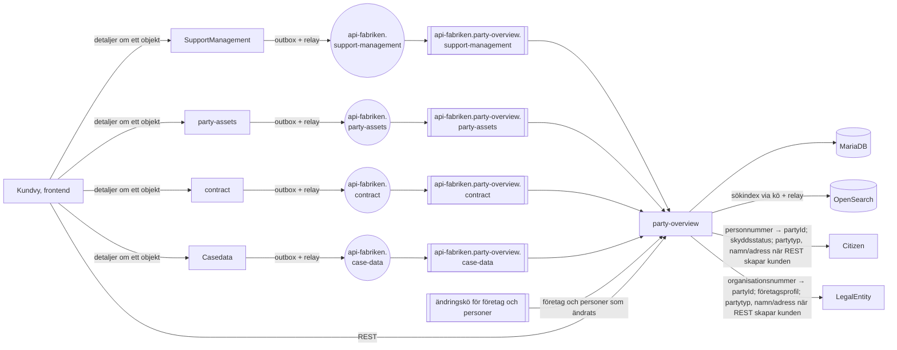

# 1. Översikt

Del av [arkitekturen för party-overview](README.md).

|      Del       |                                                                                                              Ansvar                                                                                                               |
|----------------|-----------------------------------------------------------------------------------------------------------------------------------------------------------------------------------------------------------------------------------|
| Publicerare    | Äger sina objekt. Varje ändring publiceras som hela objektets tillstånd (`UPDATE`) eller som `DELETE`. Kan publicera om allt (grundladdning).                                                                                     |
| RabbitMQ       | En exchange per publicerare och en kö per källa för party-overview, och en kö för ändringar av företag och personer. Varje kö har en dead letter-kö. Topologin deklareras i varje tjänsts driftkonfiguration (spring-boot-chart). |
| party-overview | Gör upsert av kunder och engagemang, för historik och teknisk logg, äger noteringarna och exponerar kundvyn via REST.                                                                                                             |
| OpenSearch     | Sökindex för fritextsökning bland kunderna. MariaDB är master, och indexet kan alltid byggas om därifrån.                                                                                                                         |
| Frontend       | Bygger kundvyn från party-overview och hämtar detaljer om ett objekt från källsystemet med `source` och `objectId`.                                                                                                               |

