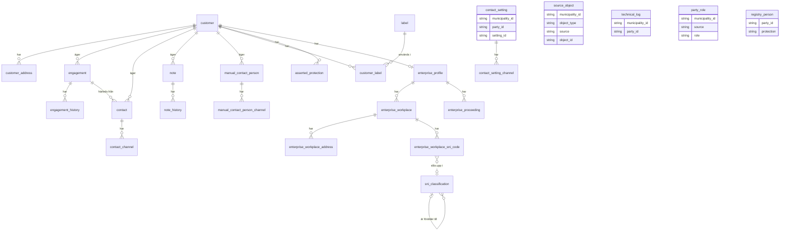

# 4. Datamodell

Del av [arkitekturen för party-overview](README.md).

## 4.1 Översikt

`source_object`, `technical_log`, `party_role`, `registry_person`, `contact_setting`, `search_index_queue` och
`shedlock` står fristående, utan FK. `sni_classification` har bara en FK till sig själv, och arbetsställenas SNI-koder
slås upp i den med koden, utan FK ([beslut 72]). `label` hör inte till någon kund, och `customer_label` har en FK till
både kunden och etiketten ([beslut 73]).

## 4.2 Gemensamt för alla tabeller

- `id varchar(36)`, UUID från `@UuidGenerator` ([beslut 63]). Undantagen är `contact_channel`,
  `manual_contact_person_channel`, `contact_setting_channel` och `customer_label`, som har sammansatta primärnycklar,
  `search_index_queue` och `enterprise_profile`, som nycklas på `customer_id`, `sni_classification`, som nycklas på
  SNI-koden, och `shedlock`.
- `municipality_id varchar(8)` finns på `customer` och på de tabeller som läses utan att gå via en kund: `engagement`
  (uppslag per källobjekt, [§3.5]), `source_object`, `technical_log`, `party_role`, `registry_person`,
  `contact_setting`, `label` och `search_index_queue`. Övriga tabeller nås via sin förälder och har ingen egen
  kommunkolumn. `sni_classification` gäller alla kommuner och har ingen kommunkolumn. `contact` och
  `manual_contact_person` nås också på `party_id` när en persons kontaktrader raderas, och då avgörs kommunen via
  `customer_id` ([§5.3]).
- `namespace varchar(32)` finns på `engagement`, `contact`, `manual_contact_person`, `note` och `label` ([§5.1]).
- En adress har samma kolumner i `customer_address`, `contact`, `manual_contact_person` och
  `enterprise_workplace_address`: `address_type varchar(32)`, `care_of`, `street`, `city` och `country varchar(255)`
  samt `postal_code varchar(16)`. Alla fyra entiteterna använder samma `@Embeddable`, med nullbara kolumner, `equals`
  och `hashCode` ([§5.2]). `customer_address` och `enterprise_workplace_address` gör `address_type` obligatorisk med
  `@AttributeOverride`. En inbäddad adress vars kolumner alla är null läses som null, och då saknar kontaktraden adress.
- Kolumner som slutar på `_id` men inte pekar på någon tabell i party-overview:
  - `municipality_id`
  - `party_id`: partens partyId, som är Citizens `personId` för en person och LegalEntitys id för ett företag
  - `registry_party_id`: det partyId vars skydd hämtas från folkbokföringen ([§5.4])
  - `object_id`: objektets id i källsystemet, `objectId` i [§3.1]
  - `message_id`: AMQP-egenskapen `message-id` ([§3.1]). Den finns bara i den tekniska loggen och knyter en ändring
    till sitt meddelande. dept44-starter-rabbitmq loggar id:t för varje meddelande, både hos publiceraren och i
    party-overview, men PII-maskningen maskerar det i loggraderna, eftersom det är ett UUID ([beslut 47], [§12]).
  - `request_id`: `x-request-id`
- Tidsstämplar är `datetime(6)` med `@TimeZoneStorage(NORMALIZE)`, sätts i `@PrePersist`/`@PreUpdate` och trunkeras
  till millisekunder.
- Varje FK under `customer` har `on delete cascade`. I entiteterna motsvaras det av `@ManyToOne(fetch = LAZY)`,
  `@ForeignKey(name = …)` och `@OnDelete(action = CASCADE)` på barnet, medan föräldern inte har någon kollektion. På
  `@ElementCollection` sitter `@OnDelete` på kollektionen. Om Hibernate inte genererar kaskaden för kollektionstabellen,
  vilket `schema.sql` visar, modelleras `contact_channel` i stället som en entitet med `@ManyToOne` och samma
  primärnyckel. Valet görs i C2. `enterprise_profile` har `@OneToOne(fetch = LAZY)` med `@MapsId`, så att kundens id
  också är profilens, och profilens barn har sina FK mot profilen.
- `customer_label` har dessutom en FK till `label` med `on delete cascade`. Entiteten `CustomerLabelEntity` har en
  `@EmbeddedId` och två `@ManyToOne(fetch = LAZY)` med `@MapsId`, `@ForeignKey` och `@OnDelete(action = CASCADE)`, en
  mot kunden och en mot etiketten. Varken kunden eller etiketten har någon kollektion, så Hibernate raderar bara
  etikettens egen rad och lämnar referenserna till databasens kaskad, precis som en radering direkt i databasen
  ([§5.7]).
- Index, unika nycklar och FK har samma namn i `@Table`/`@ForeignKey` och i Flyway: `uq_<tabell>_<kolumner>`,
  `idx_<tabell>_<kolumner>` och `fk_<tabell>_<kolumn>`. Ett namn får vara högst 64 tecken, MariaDB:s gräns för
  identifierare. Engagemangets unika nyckel är den enda som skulle gå över gränsen och namnges därför efter vad den
  betyder ([§4.3]).
- Enum-kolumner lagras som `varchar` och har inga check-constraints, så att ett nytt värde inte kräver en migrering.
- `text`-kolumner mappas med `@Column(columnDefinition = "text")`, så att `schema.sql` och Flyway får samma typ.
- Barnrader ersätts mitt i en transaktion med en bulk-delete med `flushAutomatically = true` men utan
  `clearAutomatically`, och de nya raderna skrivs med nya id:n. Det gäller kundens adresser, engagemangens kontakter
  och profilens arbetsställen och förfaranden, vars egna barn tas bort av databasens kaskad. En skrivande transaktion
  laddar aldrig barnraderna. `clearAutomatically` används bara när kunden raderas, sist i transaktionen ([§3.6]).
  Profilen själv uppdateras på den hanterade entiteten, så att `created` ligger kvar och `modified` sätts.

## 4.3 Tabellerna

**`customer`**: en kund per kommun och partyId.

|          Kolumn          |     Typ      |  Null  |                                                                                                                Anmärkning                                                                                                                |
|--------------------------|--------------|--------|------------------------------------------------------------------------------------------------------------------------------------------------------------------------------------------------------------------------------------------|
| `id`                     | varchar(36)  | nej    | PK                                                                                                                                                                                                                                       |
| `municipality_id`        | varchar(8)   | nej    |                                                                                                                                                                                                                                          |
| `party_id`               | varchar(36)  | nej    |                                                                                                                                                                                                                                          |
| `party_type`             | varchar(16)  | nej    | `PRIVATE` eller `ENTERPRISE`                                                                                                                                                                                                             |
| `name`                   | varchar(255) | ja     |                                                                                                                                                                                                                                          |
| `name_address_modified`  | datetime(6)  | ja     | `sourceModified` för det namn och de adresser som är lagrade ([§5.2])                                                                                                                                                                    |
| `protection_level`       | varchar(32)  | nej    | Effektiv nivå: `NONE`, `UNKNOWN`, `SECRECY_MARKING` eller `PROTECTED_REGISTRATION` ([§5.4])                                                                                                                                              |
| `registry_party_id`      | varchar(36)  | ja     | Den person vars skydd hämtas från folkbokföringen: kunden själv för `PRIVATE`, ägaren för en enskild firma. null för andra företag, och när det inte gick att avgöra om ett företag är en enskild firma eller vem som äger den ([§5.4]). |
| `registry_protection`    | varchar(32)  | ja     | Folkbokföringens nivå enligt Citizen, eller `UNKNOWN` när den inte gick att få. null för ett företag som inte är en enskild firma.                                                                                                       |
| `registry_checked`       | datetime(6)  | ja     | När anropet till Citizen startade, för det svar som gäller. null när Citizen inte svarade. Ett svar skrivs bara om anropet startade senare ([§5.4]).                                                                                     |
| `registry_classified`    | varchar(32)  | ja     | Citizens värde för `classified`, trimmat, för samma person som `registry_protection`. null tills Citizen har svarat, och när Citizen saknar post ([§5.4]).                                                                               |
| `registry_protected_nr`  | varchar(32)  | ja     | Citizens värde för `protectedNR`, som `registry_classified` ([§5.4])                                                                                                                                                                     |
| `legal_entity_not_found` | datetime(6)  | ja     | När anropet till LegalEntity startade i den nattliga kontrollen, om LegalEntity svarade 404 för partyId:t. null tills LegalEntity svarar 404, och igen när LegalEntity svarar med företaget. Styr när LegalEntity anropas igen ([§5.4]). |
| `created`, `modified`    | datetime(6)  | nej/ja |                                                                                                                                                                                                                                          |

Index:

- `uq_customer_municipality_id_party_id (municipality_id, party_id)`
- `idx_customer_party_id`: ändringskön, som hittar en part i alla kommuner ([§5.5])
- `idx_customer_registry_party_id`: ändringskön, som hittar de enskilda firmor som en person äger ([§5.5])

Den nattliga kontrollen går i primärnyckelns ordning och har inget eget index ([§5.4]). När den letar efter kunder
som inte har något kvar används indexen som börjar med `customer_id` i `engagement`, `note` och
`manual_contact_person`, och nyckeln i `source_object` ([§3.6]).

**`customer_address`**: kundens adresser ([§5.2], [beslut 57]).

|                 Kolumn                 |     Typ      | Null |                                           Anmärkning                                            |
|----------------------------------------|--------------|------|-------------------------------------------------------------------------------------------------|
| `id`                                   | varchar(36)  | nej  | PK                                                                                              |
| `customer_id`                          | varchar(36)  | nej  | FK `fk_customer_address_customer_id`, cascade                                                   |
| `address_type`                         | varchar(32)  | nej  | `POSTAL_ADDRESS`, `VISITING_ADDRESS`, `INVOICE_ADDRESS` eller `POPULATION_REGISTRATION_ADDRESS` |
| `care_of`, `street`, `city`, `country` | varchar(255) | ja   |                                                                                                 |
| `postal_code`                          | varchar(16)  | ja   |                                                                                                 |
| `created`                              | datetime(6)  | nej  | Raderna ersätts som helhet och uppdateras aldrig.                                               |

Index: `idx_customer_address_customer_id`.

**`asserted_protection`**: skyddet som en källa har angett i ett `CUSTOMER`-meddelande, en rad per kund och källa
([beslut 53]).

|        Kolumn         |     Typ     |  Null  |                    Anmärkning                    |
|-----------------------|-------------|--------|--------------------------------------------------|
| `id`                  | varchar(36) | nej    | PK                                               |
| `customer_id`         | varchar(36) | nej    | FK `fk_asserted_protection_customer_id`, cascade |
| `source`              | varchar(64) | nej    |                                                  |
| `protection`          | varchar(32) | nej    | `SECRECY_MARKING` eller `PROTECTED_REGISTRATION` |
| `created`, `modified` | datetime(6) | nej/ja |                                                  |

Index: `uq_asserted_protection_customer_id_source (customer_id, source)`. Ett `CUSTOMER UPDATE` utan `protection`
tar bort källans rad.

**`enterprise_profile`**: företagsuppgifter från LegalEntity, högst en rad per företagskund ([§5.5], [beslut 58]).
Raden och dess barn ersätts som helhet.

|                                 Kolumn                                  |             Typ              |  Null  |                                      Anmärkning                                      |
|-------------------------------------------------------------------------|------------------------------|--------|--------------------------------------------------------------------------------------|
| `customer_id`                                                           | varchar(36)                  | nej    | PK och FK `fk_enterprise_profile_customer_id`, cascade                               |
| `legal_form_code`, `legal_form`                                         | varchar(8), varchar(255)     | ja     | SCB:s juridiska form                                                                 |
| `company_form`                                                          | varchar(64)                  | ja     | Bolagsverkets företagsform                                                           |
| `registered_office_municipality_code`, `registered_office_municipality` | varchar(8), varchar(255)     | ja     | Kommunen där företaget har sitt säte. Kan skilja sig från kundens `municipality_id`. |
| `registered`, `deregistered`                                            | date                         | ja     |                                                                                      |
| `deregistration_reason_code`, `deregistration_reason`                   | varchar(32), varchar(255)    | ja     |                                                                                      |
| `employee_size_class`, `employee_size`                                  | varchar(8), varchar(64)      | ja     | SCB:s storleksklass, t.ex. `8` och "200–499 anställda"                               |
| `revenue_size_class`, `revenue_size`, `revenue_year`                    | varchar(8), varchar(64), int | ja     |                                                                                      |
| `workplace_count`                                                       | int                          | ja     |                                                                                      |
| `business_description`                                                  | text                         | ja     |                                                                                      |
| `email`, `phone_number`                                                 | varchar(255)                 | ja     |                                                                                      |
| `fetched`                                                               | datetime(6)                  | nej    | När anropet till LegalEntity startade. Bara en senare hämtning skriver över.         |
| `content_hash`                                                          | varchar(64)                  | nej    | SHA-256 av den mappade profilen. En oförändrad profil skrivs inte om ([§5.5]).       |
| `created`, `modified`                                                   | datetime(6)                  | nej/ja |                                                                                      |

**`enterprise_workplace`**: företagets arbetsställen ([§5.5]).

|                 Kolumn                 |           Typ           | Null |                                 Anmärkning                                  |
|----------------------------------------|-------------------------|------|-----------------------------------------------------------------------------|
| `id`                                   | varchar(36)             | nej  | PK                                                                          |
| `customer_id`                          | varchar(36)             | nej  | FK `fk_enterprise_workplace_customer_id` till `enterprise_profile`, cascade |
| `cfar_number`                          | varchar(16)             | ja   | SCB:s nummer för arbetsstället                                              |
| `name`                                 | varchar(255)            | ja   |                                                                             |
| `main_workplace`                       | bit                     | nej  |                                                                             |
| `employee_size_class`, `employee_size` | varchar(8), varchar(64) | ja   |                                                                             |
| `phone_number`                         | varchar(255)            | ja   |                                                                             |

Index: `idx_enterprise_workplace_customer_id`.

**`enterprise_workplace_address`**: arbetsställets postadress och besöksadress, med kolumnerna i [§4.2].

|     Kolumn     |     Typ     | Null |                                 Anmärkning                                  |
|----------------|-------------|------|-----------------------------------------------------------------------------|
| `id`           | varchar(36) | nej  | PK                                                                          |
| `workplace_id` | varchar(36) | nej  | FK `fk_enterprise_workplace_address_workplace_id`, cascade                  |
| adressfälten   | [§4.2]      | ja   | `address_type` är `POSTAL_ADDRESS` eller `VISITING_ADDRESS` och aldrig null |

Index: `idx_enterprise_workplace_address_workplace_id`.

**`enterprise_workplace_sni_code`**: arbetsställets SNI-koder, i LegalEntitys ordning ([§5.5]).

|     Kolumn     |     Typ      | Null |                                Anmärkning                                |
|----------------|--------------|------|--------------------------------------------------------------------------|
| `id`           | varchar(36)  | nej  | PK                                                                       |
| `workplace_id` | varchar(36)  | nej  | FK `fk_enterprise_workplace_sni_code_workplace_id`, cascade              |
| `ordinal`      | int          | nej  | 1 är arbetsställets första kod                                           |
| `sni_code`     | varchar(16)  | nej  | Utan punkter och blanksteg. Pekar på `sni_classification.code`, utan FK. |
| `name`         | varchar(255) | ja   |                                                                          |

Index: `uq_enterprise_workplace_sni_code_workplace_id_ordinal (workplace_id, ordinal)` och
`idx_enterprise_workplace_sni_code_sni_code`.

Företagets SNI-koder lagras inte. De räknas fram ur arbetsställenas när profilen läses och indexeras ([§5.5]).

**`sni_classification`**: SNI-trädet, med en nod per kod från sökvägarna som LegalEntity ger ([§5.5], [beslut 72]).
Noderna hör inte till någon kund och raderas aldrig.

|        Kolumn         |     Typ      |  Null  |                                                 Anmärkning                                                 |
|-----------------------|--------------|--------|------------------------------------------------------------------------------------------------------------|
| `code`                | varchar(16)  | nej    | PK. Koden utan punkter och blanksteg, t.ex. `I`, `56`, `563`, `5630` och `56300`                           |
| `level`               | varchar(16)  | nej    | `SECTION`, `DIVISION`, `GROUP`, `CLASS` eller `SUBCLASS`                                                   |
| `parent_code`         | varchar(16)  | ja     | FK `fk_sni_classification_parent_code` till `sni_classification`, utan kaskad. Null bara för en avdelning. |
| `name`                | varchar(255) | ja     |                                                                                                            |
| `created`, `modified` | datetime(6)  | nej/ja |                                                                                                            |

Index: `idx_sni_classification_parent_code`.

**`enterprise_proceeding`**: pågående likvidation, konkurs eller rekonstruktion ([§5.5]).

|    Kolumn     |     Typ      | Null |                                  Anmärkning                                  |
|---------------|--------------|------|------------------------------------------------------------------------------|
| `id`          | varchar(36)  | nej  | PK                                                                           |
| `customer_id` | varchar(36)  | nej  | FK `fk_enterprise_proceeding_customer_id` till `enterprise_profile`, cascade |
| `code`        | varchar(32)  | ja   |                                                                              |
| `name`        | varchar(255) | ja   |                                                                              |
| `from_date`   | date         | ja   |                                                                              |

Index: `idx_enterprise_proceeding_customer_id`.

**`engagement`**: ett källobjekt sett från en kund ([beslut 8]).

|          Kolumn          |      Typ      |  Null  |                                     Anmärkning                                      |
|--------------------------|---------------|--------|-------------------------------------------------------------------------------------|
| `id`                     | varchar(36)   | nej    | PK                                                                                  |
| `customer_id`            | varchar(36)   | nej    | FK `fk_engagement_customer_id`, cascade                                             |
| `municipality_id`        | varchar(8)    | nej    |                                                                                     |
| `namespace`              | varchar(32)   | ja     | null betyder globalt                                                                |
| `object_type`            | varchar(32)   | nej    | `ERRAND`, `ASSET` eller `CONTRACT`                                                  |
| `source`                 | varchar(64)   | nej    | `SUPPORT_MANAGEMENT`, `PARTY_ASSETS`, `CONTRACT` eller `CASE_DATA`                  |
| `object_id`              | varchar(255)  | nej    | Objektets id i källsystemet. Ingen FK ([§4.2]).                                     |
| `reference`, `category`  | varchar(255)  | ja     |                                                                                     |
| `title`                  | varchar(512)  | ja     |                                                                                     |
| `status`                 | varchar(255)  | ja     |                                                                                     |
| `roles`                  | varchar(1024) | ja     | Kundens roller, sorterade och kommaseparerade (`AttributeConverter`)                |
| `party_protection`       | varchar(32)   | ja     | Skyddsnivån som källan angav för kunden i det här objektet                          |
| `valid_from`, `valid_to` | date          | ja     |                                                                                     |
| `source_created`         | datetime(6)   | ja     |                                                                                     |
| `source_modified`        | datetime(6)   | nej    | Sorteringsnyckel. `modified` ändras av varje grundladdning och duger inte till det. |
| `created`, `modified`    | datetime(6)   | nej/ja |                                                                                     |

Index:

- `uq_engagement_source_object_customer_id (municipality_id, object_type, source, object_id, customer_id)`: en rad per
  källobjekt och kund. Prefixet utan `customer_id` hittar också alla rader för ett källobjekt. Nyckeln är cirka 1,6 kB
  och ryms inom InnoDB:s gräns på 3072 byte.
- `idx_engagement_customer_id_source_modified`: kundvyns lista, och kontrollen om kunden har engagemang kvar.
- `idx_engagement_customer_id_object_type_source_modified`: listan filtrerad på typ.

**`engagement_history`**: aktiviteter från meddelandena ([beslut 18]).

|               Kolumn                |            Typ            | Null |                    Anmärkning                     |
|-------------------------------------|---------------------------|------|---------------------------------------------------|
| `id`                                | varchar(36)               | nej  | PK                                                |
| `engagement_id`                     | varchar(36)               | nej  | FK `fk_engagement_history_engagement_id`, cascade |
| `type`                              | varchar(64)               | nej  |                                                   |
| `description`                       | varchar(1024)             | ja   |                                                   |
| `performed_by_type`, `performed_by` | varchar(32), varchar(255) | ja   |                                                   |
| `occurred_at`                       | datetime(6)               | nej  |                                                   |
| `created`                           | datetime(6)               | nej  |                                                   |

Index: `idx_engagement_history_engagement_id_occurred_at`.

**`contact`**: kontaktuppgifter som syns per namespace ([§5.3]).

|        Kolumn         |     Typ      | Null |                                                                                                                             Anmärkning                                                                                                                             |
|-----------------------|--------------|------|--------------------------------------------------------------------------------------------------------------------------------------------------------------------------------------------------------------------------------------------------------------------|
| `id`                  | varchar(36)  | nej  | PK                                                                                                                                                                                                                                                                 |
| `customer_id`         | varchar(36)  | nej  | FK `fk_contact_customer_id`, cascade                                                                                                                                                                                                                               |
| `engagement_id`       | varchar(36)  | ja   | FK `fk_contact_engagement_id`, cascade. null betyder att uppgiften kommer från ett `CUSTOMER`-meddelande eller är en funktionär från LegalEntity ([§5.5]).                                                                                                         |
| `namespace`           | varchar(32)  | ja   | null betyder globalt                                                                                                                                                                                                                                               |
| `source`              | varchar(64)  | nej  | Källan, eller `LEGAL_ENTITY` för en funktionär                                                                                                                                                                                                                     |
| `contact_type`        | varchar(32)  | nej  | `CUSTOMER` (kundens egna uppgifter) eller `CONTACT_PERSON`. En kontaktperson med `engagement_id` hör till objektet och visas bara på engagemanget, och en utan är en funktionär från LegalEntity ([§5.3], [§5.5]).                                                 |
| `party_id`            | varchar(36)  | ja   | Kontaktpersonens partyId, när det är känt. Med det hittas raderna när parten raderas, och kunden när parten är kund i kommunen ([§5.3]).                                                                                                                           |
| `registry_party_id`   | varchar(36)  | ja   | Den person vars skydd hämtas från folkbokföringen: kontaktpersonen själv för en person, ägaren för en enskild firma. Raden i `registry_person` har samma partyId. null för andra företag, när det inte gick att avgöra och när `contact_type = CUSTOMER` ([§5.3]). |
| `party_protection`    | varchar(32)  | ja   | Partens `protection` i meddelandet: `SECRECY_MARKING` eller `PROTECTED_REGISTRATION` ([§3.1])                                                                                                                                                                      |
| `fallback_protection` | varchar(32)  | ja   | Nivån för en kontaktperson utan `registry_party_id`: `NONE` för ett företag som inte är en enskild firma, annars `UNVERIFIED`. null när `registry_party_id` finns och när `contact_type = CUSTOMER` ([§5.3]).                                                      |
| `name`                | varchar(255) | ja   | Kontaktpersonens namn                                                                                                                                                                                                                                              |
| `role`                | varchar(64)  | ja   | Kontaktpersonens roll, eller funktionärens funktion                                                                                                                                                                                                                |
| adressfälten          | [§4.2]       | ja   | Kontaktpersonens adress ([§5.3]). null när `contact_type = CUSTOMER`.                                                                                                                                                                                              |
| `created`             | datetime(6)  | nej  | Raderna ersätts som helhet och uppdateras aldrig.                                                                                                                                                                                                                  |

Index: `idx_contact_customer_id_engagement_id_namespace`, `idx_contact_engagement_id`, `idx_contact_party_id` och
`idx_contact_registry_party_id`. Det första ger kundens egna rader, de utan `engagement_id`, utan att läsa raderna från
engagemangen. Det sista används när den nattliga kontrollen rensar `registry_person` ([§5.4]).

Kontaktpersonens skyddsnivå lagras inte på raden. Den räknas fram när raden läses ([§5.3]).

**`contact_channel`**: `@ElementCollection` på `contact`, som en `Set`. Primärnyckeln är `(contact_id, type, value)`,
och en kanal som förekommer flera gånger sparas en gång.

|    Kolumn    |     Typ      |                       Null                       |
|--------------|--------------|--------------------------------------------------|
| `contact_id` | varchar(36)  | nej, FK `fk_contact_channel_contact_id`, cascade |
| `type`       | varchar(32)  | nej. `EMAIL` eller `PHONE` ([§3.1]).             |
| `value`      | varchar(255) | nej                                              |

**`manual_contact_person`**: kontaktpersoner som har lagts till via REST ([§5.3], [beslut 65]).

|          Kolumn           |            Typ            | Null |                     Anmärkning                     |
|---------------------------|---------------------------|------|----------------------------------------------------|
| `id`                      | varchar(36)               | nej  | PK                                                 |
| `customer_id`             | varchar(36)               | nej  | FK `fk_manual_contact_person_customer_id`, cascade |
| `namespace`               | varchar(32)               | ja   | null betyder globalt                               |
| `name`                    | varchar(255)              | nej  |                                                    |
| `role`                    | varchar(64)               | ja   |                                                    |
| adressfälten              | [§4.2]                    | ja   | Kontaktpersonens adress                            |
| `party_id`                | varchar(36)               | ja   | Kontaktpersonens partyId, när det angavs           |
| `registry_party_id`       | varchar(36)               | ja   | Som på `contact`                                   |
| `fallback_protection`     | varchar(32)               | ja   | Som på `contact`                                   |
| `version`                 | bigint                    | nej  | `@Version`, och ETag i API:t ([§6.1])              |
| `created`, `created_by`   | datetime(6), varchar(255) | nej  | `created_by` från `X-Sent-By`                      |
| `modified`, `modified_by` | datetime(6), varchar(255) | ja   | `modified_by` från `X-Sent-By`                     |

Index: `idx_manual_contact_person_customer_id_namespace`, `idx_manual_contact_person_party_id` och
`idx_manual_contact_person_registry_party_id`.

**`manual_contact_person_channel`**: kontaktpersonens kanaler, modellerade som `contact_channel`, med primärnyckeln
`(contact_person_id, type, value)` och FK `fk_manual_contact_person_channel_contact_person_id`, cascade.

**`registry_person`**: folkbokföringens status för de personer som `contact.registry_party_id` och
`manual_contact_person.registry_party_id` pekar på, en rad per person ([§5.3], [beslut 52]). Tabellen har ingen FK,
eftersom statusen gäller personen i alla kommuner. Raden skapas med IODKU.

|        Kolumn         |     Typ     |  Null  |                                                                       Anmärkning                                                                        |
|-----------------------|-------------|--------|---------------------------------------------------------------------------------------------------------------------------------------------------------|
| `id`                  | varchar(36) | nej    | PK                                                                                                                                                      |
| `party_id`            | varchar(36) | nej    | Personens partyId                                                                                                                                       |
| `municipality_id`     | varchar(8)  | nej    | Kommunen som anropen till Citizen görs med: kommunen för den kontaktrad som skapade raden                                                               |
| `protection`          | varchar(32) | nej    | Folkbokföringens nivå: `NONE`, `UNKNOWN`, `SECRECY_MARKING` eller `PROTECTED_REGISTRATION` ([§5.4])                                                     |
| `classified`          | varchar(32) | ja     | Citizens värde för `classified`, som `customer.registry_classified`                                                                                     |
| `protected_nr`        | varchar(32) | ja     | Citizens värde för `protectedNR`, som `customer.registry_protected_nr`                                                                                  |
| `checked`             | datetime(6) | ja     | När anropet till Citizen startade, för det svar som gäller. null när Citizen inte har svarat. Ett svar skrivs bara om anropet startade senare ([§5.4]). |
| `created`, `modified` | datetime(6) | nej/ja |                                                                                                                                                         |

Index: `uq_registry_person_party_id`.

**`contact_setting`**: kontaktinställningar från ContactSettings, en rad per kommun och partyId ([§5.6], [beslut 71]).
Tabellen har ingen FK, eftersom raden finns också när personen inte är kund.

|        Kolumn         |     Typ     |  Null  |                                             Anmärkning                                              |
|-----------------------|-------------|--------|-----------------------------------------------------------------------------------------------------|
| `id`                  | varchar(36) | nej    | PK                                                                                                  |
| `municipality_id`     | varchar(8)  | nej    |                                                                                                     |
| `party_id`            | varchar(36) | nej    | Personens eller företagets partyId                                                                  |
| `setting_id`          | varchar(36) | nej    | Inställningens id i ContactSettings, samma som `object_id` i `source_object`                        |
| `source_modified`     | datetime(6) | nej    | Meddelandets `sourceModified`. Avgör om en inställning med ett annat id får ersätta raden ([§5.6]). |
| `created`, `modified` | datetime(6) | nej/ja |                                                                                                     |

Index: `uq_contact_setting_municipality_id_party_id`, som också används när kunden läses och indexeras, och
`uq_contact_setting_setting_id`.

**`contact_setting_channel`**: inställningens kanaler, modellerade som `contact_channel`, med primärnyckeln
`(contact_setting_id, type, value)` och FK `fk_contact_setting_channel_contact_setting_id`, cascade. `type` är `EMAIL`
eller `PHONE`.

**`note`**

|          Kolumn           |            Typ            | Null |                     Anmärkning                     |
|---------------------------|---------------------------|------|----------------------------------------------------|
| `id`                      | varchar(36)               | nej  | PK                                                 |
| `customer_id`             | varchar(36)               | nej  | FK `fk_note_customer_id`, cascade                  |
| `namespace`               | varchar(32)               | ja   | null betyder globalt                               |
| `subject`                 | varchar(255)              | ja   | Högst 255 tecken (`@Size`)                         |
| `body`                    | text                      | nej  | Högst 10 000 tecken (`@Size`)                      |
| `created`, `created_by`   | datetime(6), varchar(255) | nej  | `created_by` från `X-Sent-By`                      |
| `modified`, `modified_by` | datetime(6), varchar(255) | ja   | `modified_by` från `X-Sent-By`                     |
| `version`                 | bigint                    | nej  | `@Version`, och ETag i API:t ([§6.1], [beslut 61]) |

Index: `idx_note_customer_id_namespace_created`.

`created_by` och `modified_by` är värdet i `X-Sent-By`, utan typen, t.ex. `joe01doe` för
`joe01doe; type=adAccount` ([§6]). `created_by` sätts när noteringen skapas och ändras aldrig, och `modified_by` sätts
vid varje ändring.

**`note_history`**: samma kolumner som `engagement_history`, med `note_id` (FK `fk_note_history_note_id`, cascade) i
stället för `engagement_id`. `type` är `CREATED` eller `UPDATED`. `performed_by` är värdet i `X-Sent-By`, och
`performed_by_type` är typen enligt dept44:s `Identifier.Type`: `AD_ACCOUNT`, `PARTY_ID` eller `CUSTOM`. De gemensamma
kolumnerna ligger i en `@MappedSuperclass AbstractHistoryEntity`.

Index: `idx_note_history_note_id_occurred_at`.

**`label`**: etiketterna, en katalog per kommun ([§5.7], [beslut 73]). Etiketterna hör inte till någon kund och
raderas bara via REST eller direkt i databasen.

|         Kolumn          |            Typ            | Null |                                     Anmärkning                                      |
|-------------------------|---------------------------|------|-------------------------------------------------------------------------------------|
| `id`                    | varchar(36)               | nej  | PK                                                                                  |
| `municipality_id`       | varchar(8)                | nej  |                                                                                     |
| `namespace`             | varchar(32)               | ja   | null betyder globalt                                                                |
| `name`                  | varchar(64)               | nej  | Trimmat, som det skrevs när etiketten skapades                                      |
| `namespace_key`         | varchar(32)               | ja   | Genererad: `coalesce(namespace, '')`, `persistent`. Aldrig null.                    |
| `name_key`              | varchar(64)               | ja   | Genererad: `lower(name)`, `persistent`, med kollationen `utf8mb4_bin`. Aldrig null. |
| `created`, `created_by` | datetime(6), varchar(255) | nej  | `created_by` från `X-Sent-By`                                                       |

Index: `uq_label_municipality_id_namespace_key_name_key (municipality_id, namespace_key, name_key)`, en etikett per
kommun, namespace och namn utan hänsyn till stora och små bokstäver. MariaDB räknar varje null som ett eget värde i en
unik nyckel, så nyckeln har `namespace_key` och inte `namespace`. `utf8mb4_bin` gör att `Hög` och `Hog` är olika
etiketter, oavsett serverns kollation. Förslagen läser kommunens etiketter med nyckelns början ([§5.7]).

`namespace_key` och `name_key` mappas i `LabelEntity` med `insertable = false, updatable = false` och uttrycket i
`columnDefinition`, så att `schema.sql` får samma kolumner som Flyway.

**`customer_label`**: kundens etiketter ([§5.7]).

|         Kolumn          |            Typ            | Null |                                Anmärkning                                |
|-------------------------|---------------------------|------|--------------------------------------------------------------------------|
| `customer_id`           | varchar(36)               | nej  | PK och FK `fk_customer_label_customer_id`, cascade                       |
| `label_id`              | varchar(36)               | nej  | PK och FK `fk_customer_label_label_id` till `label`, cascade             |
| `created`, `created_by` | datetime(6), varchar(255) | nej  | När och av vem etiketten lades på kunden. `created_by` från `X-Sent-By`. |

Primärnyckeln är `(customer_id, label_id)`, så en etikett finns högst en gång per kund, och den ger kundens etiketter.
Index: `idx_customer_label_label_id`, som hittar kunderna när en etikett raderas.

**`source_object`**: versionsregistret ([beslut 12]). Tabellen har ingen FK. För `CUSTOMER` är `object_id` kundens
partyId. De raderna blir aldrig tombstones utan raderas med kunden ([§3.6]). Övriga rader innehåller inga
kunduppgifter.

|        Kolumn         |     Typ      |                                      Null                                      |
|-----------------------|--------------|--------------------------------------------------------------------------------|
| `id`                  | varchar(36)  | nej                                                                            |
| `municipality_id`     | varchar(8)   | nej                                                                            |
| `object_type`         | varchar(32)  | nej                                                                            |
| `source`              | varchar(64)  | nej                                                                            |
| `object_id`           | varchar(255) | nej. Objektets id i källsystemet, och för `CUSTOMER` kundens partyId ([§4.2]). |
| `version`             | bigint       | nej                                                                            |
| `deleted`             | bit          | nej                                                                            |
| `created`, `modified` | datetime(6)  | nej/ja                                                                         |

Index: `uq_source_object_municipality_id_object_type_object_id_source`. Med källan sist hittas alla källors rader för
ett objekt, t.ex. en kunds rader för `CUSTOMER`, med nyckelns början.

**`technical_log`**: den tekniska loggen ([beslut 11], [§8]). Tabellen har ingen FK.

|       Kolumn       |     Typ      | Null |                            Anmärkning                             |
|--------------------|--------------|------|-------------------------------------------------------------------|
| `id`               | varchar(36)  | nej  |                                                                   |
| `municipality_id`  | varchar(8)   | nej  |                                                                   |
| `party_id`         | varchar(36)  | nej  |                                                                   |
| `channel`          | varchar(16)  | nej  | `MESSAGE`, `REST` eller `SCHEDULER`                               |
| `message_id`       | varchar(36)  | ja   | Vid kanalen `MESSAGE` ([§4.2])                                    |
| `request_id`       | varchar(255) | ja   | Kapas till 255 tecken, eftersom headern inte har någon längdgräns |
| `source`           | varchar(64)  | ja   |                                                                   |
| `object_type`      | varchar(32)  | ja   |                                                                   |
| `object_id`        | varchar(255) | ja   |                                                                   |
| `operation`        | varchar(16)  | ja   | `UPDATE` eller `DELETE`                                           |
| `source_version`   | bigint       | ja   |                                                                   |
| `outcome`          | varchar(32)  | nej  | [§8.1]                                                            |
| `performed_by`     | varchar(255) | ja   | Vid REST                                                          |
| `protection_level` | varchar(32)  | ja   | Den nya nivån vid `PROTECTION_CHANGED`                            |
| `created`          | datetime(6)  | nej  |                                                                   |

Index: `idx_technical_log_municipality_id_party_id_created` och `idx_technical_log_created`, som används vid gallring
och manuell radering på datum ([§8.2]).

**`party_role`**: konfiguration av partsrollerna, som avgör vem i ett meddelande som blir kund och vem som blir
kontaktperson ([§5.3], [beslut 15]).

|         Kolumn          |            Typ            | Null |                  Anmärkning                  |
|-------------------------|---------------------------|------|----------------------------------------------|
| `id`                    | varchar(36)               | nej  |                                              |
| `municipality_id`       | varchar(8)                | nej  |                                              |
| `source`                | varchar(64)               | nej  |                                              |
| `role`                  | varchar(64)               | nej  | Källans rollkod                              |
| `classification`        | varchar(32)               | nej  | `CUSTOMER`, `CONTACT_PERSON` eller `IGNORED` |
| `created`, `created_by` | datetime(6), varchar(255) | nej  |                                              |

Index: `uq_party_role_municipality_id_source_role`.

**`search_index_queue`**: kunder som ska indexeras om eller tas bort ur sökindexet ([§6.2]). Tabellen har ingen FK, så
att en raderad kund finns kvar i kön tills den har tagits bort ur indexet.

|      Kolumn       |     Typ     | Null |                                       Anmärkning                                       |
|-------------------|-------------|------|----------------------------------------------------------------------------------------|
| `customer_id`     | varchar(36) | nej  | PK. Flera markeringar av samma kund slås ihop.                                         |
| `municipality_id` | varchar(8)  | nej  |                                                                                        |
| `version`         | bigint      | nej  | Ökas vid varje ny markering                                                            |
| `attempts`        | int         | nej  | Antal misslyckade försök, förval 0                                                     |
| `priority`        | bit         | nej  | Satt när markeringen gäller en radering ([§6.2]). Sänks aldrig av en senare markering. |
| `queued`          | datetime(6) | nej  |                                                                                        |

Index: `idx_search_index_queue_priority_queued (priority, queued)`. Relayn läser de prioriterade raderna och övriga
rader med var sin fråga, med likhet på `priority`, så att indexet ger `queued`-ordningen ([§6.2]).

**`shedlock`**: standardtabellen för dept44-starter-scheduler.

## 4.4 Flyway

- Allt hamnar i en ny `V1_0__create_tables.sql` som ersätter POC:ns. Kommande ändringar blir
  `V1_<n>__<beskrivning>.sql`.
- FK skrivs med `on delete cascade` i Flyway och med `@OnDelete` i entiteterna.
  `src/test/resources/db/schema/schema.sql` genereras från entiteterna.
- IT-profilen kör Flyway och `schema-generation: validate`. Validate kontrollerar kolumner men inte index eller FK.
  Därför finns `SchemaParityIT` ([§10]).

[§3.1]: 03-meddelanden.md#31-krav-på-det-gemensamma-formatet
[§3.5]: 03-meddelanden.md#35-tillämpning
[beslut 47]: 00-beslutslogg.md#beslut-47-meddelandets-id-finns-bara-i-den-tekniska-loggen
[§4.2]: #42-gemensamt-för-alla-tabeller
[§4.3]: #43-tabellerna
[§5.1]: 05-synlighet-och-kunddata.md#51-synlighet-per-namespace
[§5.2]: 05-synlighet-och-kunddata.md#52-namn-och-adress
[§5.3]: 05-synlighet-och-kunddata.md#53-kunder-kontaktpersoner-och-kontaktuppgifter
[§5.4]: 05-synlighet-och-kunddata.md#54-skyddad-identitet
[§6.2]: 06-rest-api.md#62-kundsökning-opensearch
[§8]: 08-teknisk-logg.md
[§8.1]: 08-teknisk-logg.md#81-utfall-i-den-tekniska-loggen
[§8.2]: 08-teknisk-logg.md#82-radering-av-den-tekniska-loggen
[§10]: 10-teststrategi.md
[beslut 8]: 00-beslutslogg.md#beslut-8-en-engagemangsrad-per-kund
[beslut 11]: 00-beslutslogg.md#beslut-11-den-tekniska-loggen-har-ingen-fk-till-kunden
[beslut 12]: 00-beslutslogg.md#beslut-12-versionsvakt-i-ett-register-per-källobjekt
[beslut 15]: 00-beslutslogg.md#beslut-15-partsrollerna-avgör-vem-som-är-kund-och-kontaktperson
[beslut 18]: 00-beslutslogg.md#beslut-18-historiken-kommer-från-källans-aktiviteter
[§3.6]: 03-meddelanden.md#36-kundradering
[beslut 53]: 00-beslutslogg.md#beslut-53-skyddet-från-customer-meddelanden-lagras-per-källa
[§12]: 12-drift.md
[§6]: 06-rest-api.md
[beslut 57]: 00-beslutslogg.md#beslut-57-en-kund-kan-ha-flera-adresser-och-en-kontaktperson-har-en
[§5.5]: 05-synlighet-och-kunddata.md#55-företagsuppgifter
[beslut 58]: 00-beslutslogg.md#beslut-58-företagsuppgifter-lagras-i-en-egen-profil
[§6.1]: 06-rest-api.md#61-endpoints
[beslut 61]: 00-beslutslogg.md#beslut-61-noteringar-ändras-med-optimistisk-låsning
[beslut 63]: 00-beslutslogg.md#beslut-63-primärnycklar-är-slumpmässiga-uuid
[beslut 52]: 00-beslutslogg.md#beslut-52-kontaktpersoner-kontrolleras-mot-skyddad-identitet
[beslut 65]: 00-beslutslogg.md#beslut-65-verksamheter-lägger-till-egna-kontaktpersoner-via-rest
[§5.6]: 05-synlighet-och-kunddata.md#56-kontaktinställningar
[beslut 71]: 00-beslutslogg.md#beslut-71-kontaktinställningarna-sparas-för-alla-med-partyid
[beslut 72]: 00-beslutslogg.md#beslut-72-sni-kodernas-sökväg-kommer-från-legalentity-och-lagras-som-ett-träd
[§5.7]: 05-synlighet-och-kunddata.md#57-etiketter
[beslut 73]: 00-beslutslogg.md#beslut-73-etiketter-finns-i-en-katalog-som-kunden-pekar-på

