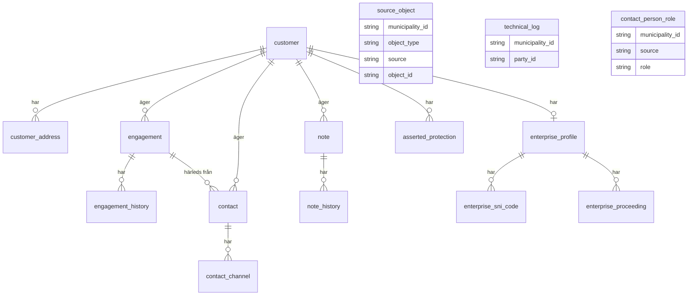

# 4. Datamodell

Del av [arkitekturen för party-overview](README.md).

## 4.1 Översikt

`source_object`, `technical_log`, `contact_person_role`, `search_index_queue` och `shedlock` står fristående, utan FK.

## 4.2 Gemensamt för alla tabeller

- `id varchar(36)`, UUID från `@UuidGenerator`. Undantagen är kollektionstabellen `contact_channel`,
  `search_index_queue` och `enterprise_profile`, som nycklas på `customer_id`, och `shedlock`.
- `municipality_id varchar(8)` finns på `customer` och på de tabeller som läses utan att gå via en kund: `engagement`
  (uppslag per källobjekt, [§3.5]), `source_object`, `technical_log`, `contact_person_role` och `search_index_queue`.
  Övriga tabeller nås via sin förälder och har ingen egen kommunkolumn. `contact` nås också på `party_id` när en
  persons kontaktrader raderas, och då avgörs kommunen via `contact.customer_id` ([§5.3]).
- `namespace varchar(32)` finns på `engagement`, `contact` och `note` ([§5.1]).
- En adress har samma kolumner i `customer_address` och `contact`: `address_type varchar(32)`, `care_of`, `street`,
  `city` och `country varchar(255)` samt `postal_code varchar(16)`. Båda entiteterna använder samma `@Embeddable`
  ([§5.2]).
- Kolumner som slutar på `_id` men inte är FK och inte pekar på någon tabell i party-overview:
  - `municipality_id`
  - `party_id`: partens partyId, som är Citizens `personId` för en person och LegalEntitys id för ett företag
  - `registry_party_id`: det partyId vars skydd hämtas från folkbokföringen ([§5.4])
  - `object_id`: objektets id i källsystemet, `objectId` i [§3.1]
  - `message_id`: AMQP-egenskapen `message-id` ([§3.1]). Den finns bara i den tekniska loggen och knyter en ändring
    till sitt meddelande. dept44-starter-rabbitmq loggar id:t för varje meddelande, både hos publiceraren och i
    party-overview, men PII-maskningen maskerar det i loggraderna, eftersom det är ett UUID ([beslut 47], [§12]).
  - `request_id`: `x-request-id`
- Tidsstämplar är `datetime(6)` med `@TimeZoneStorage(NORMALIZE)`, sätts i `@PrePersist`/`@PreUpdate` och trunkeras
  till millisekunder.
- Varje FK under `customer` har `on delete cascade`. I entiteterna motsvaras det av `@ManyToOne(fetch = LAZY)`,
  `@ForeignKey(name = …)` och `@OnDelete(action = CASCADE)` på barnet, medan föräldern inte har någon kollektion. På
  `@ElementCollection` sitter `@OnDelete` på kollektionen. Om Hibernate inte genererar kaskaden för kollektionstabellen,
  vilket `schema.sql` visar, modelleras `contact_channel` i stället som en entitet med `@ManyToOne` och en egen
  `id`-kolumn. Valet görs i C2, och tabellen i [§4.3] uppdateras då. `enterprise_profile` har `@OneToOne(fetch = LAZY)`
  med `@MapsId`, så att kundens id också är profilens, och profilens barn har sina FK mot profilen.
- Index, unika nycklar och FK har samma namn i `@Table`/`@ForeignKey` och i Flyway: `uq_<tabell>_<kolumner>`,
  `idx_<tabell>_<kolumner>` och `fk_<tabell>_<kolumn>`. Ett namn får vara högst 64 tecken, som är MariaDB:s gräns för
  identifierare. Den enda nyckel som skulle gå över gränsen, engagemangets unika nyckel, namnges därför efter vad den
  betyder ([§4.3]).
- Enum-kolumner lagras som `varchar` och har inga check-constraints, så att ett nytt värde inte kräver en migrering.

## 4.3 Tabellerna

**`customer`**: en kund per kommun och partyId.

|        Kolumn         |     Typ      |  Null  |                                                                                                                Anmärkning                                                                                                                |
|-----------------------|--------------|--------|------------------------------------------------------------------------------------------------------------------------------------------------------------------------------------------------------------------------------------------|
| `id`                  | varchar(36)  | nej    | PK                                                                                                                                                                                                                                       |
| `municipality_id`     | varchar(8)   | nej    |                                                                                                                                                                                                                                          |
| `party_id`            | varchar(36)  | nej    |                                                                                                                                                                                                                                          |
| `party_type`          | varchar(16)  | nej    | `PRIVATE` eller `ENTERPRISE`                                                                                                                                                                                                             |
| `name`                | varchar(255) | ja     | Alltid null om kunden är skyddad                                                                                                                                                                                                         |
| `profile_modified`    | datetime(6)  | ja     | `sourceModified` för det namn och de adresser som är lagrade ([§5.2])                                                                                                                                                                    |
| `protection_level`    | varchar(32)  | nej    | Effektiv nivå: `NONE`, `UNKNOWN`, `SECRECY_MARKING` eller `PROTECTED_REGISTRATION` ([§5.4])                                                                                                                                              |
| `registry_party_id`   | varchar(36)  | ja     | Den person vars skydd hämtas från folkbokföringen: kunden själv för `PRIVATE`, ägaren för en enskild firma. null för andra företag, och när det inte gick att avgöra om ett företag är en enskild firma eller vem som äger den ([§5.4]). |
| `registry_protection` | varchar(32)  | ja     | Folkbokföringens nivå enligt Citizen, eller `UNKNOWN` när den inte gick att få. null för ett företag som inte är en enskild firma.                                                                                                       |
| `registry_checked`    | datetime(6)  | ja     | När folkbokföringens nivå senast avgjordes. null så länge statusen är `UNKNOWN`.                                                                                                                                                         |
| `created`, `modified` | datetime(6)  | nej/ja |                                                                                                                                                                                                                                          |

Index:

- `uq_customer_municipality_id_party_id (municipality_id, party_id)`
- `idx_customer_party_id`: ändringskön, som hittar ett företag i alla kommuner ([§5.5])

Den nattliga kontrollen går i primärnyckelns ordning och har inget eget index ([§5.4]).

**`customer_address`**: kundens adresser ([§5.2], [beslut 57]). En skyddad kund har inga.

|                 Kolumn                 |     Typ      | Null |                                           Anmärkning                                            |
|----------------------------------------|--------------|------|-------------------------------------------------------------------------------------------------|
| `id`                                   | varchar(36)  | nej  | PK                                                                                              |
| `customer_id`                          | varchar(36)  | nej  | FK `fk_customer_address_customer_id`, cascade                                                   |
| `address_type`                         | varchar(32)  | nej  | `POSTAL_ADDRESS`, `VISITING_ADDRESS`, `INVOICE_ADDRESS` eller `POPULATION_REGISTRATION_ADDRESS` |
| `care_of`, `street`, `city`, `country` | varchar(255) | ja   |                                                                                                 |
| `postal_code`                          | varchar(16)  | ja   |                                                                                                 |
| `created`                              | datetime(6)  | nej  | Raderna ersätts som helhet och uppdateras aldrig.                                               |

Index: `idx_customer_address_customer_id`.

**`asserted_protection`**: skyddet som en källa har angett i ett `CUSTOMER`-meddelande, en rad per kund och källa
([beslut 53]).

|        Kolumn         |     Typ     |  Null  |                    Anmärkning                    |
|-----------------------|-------------|--------|--------------------------------------------------|
| `id`                  | varchar(36) | nej    | PK                                               |
| `customer_id`         | varchar(36) | nej    | FK `fk_asserted_protection_customer_id`, cascade |
| `source`              | varchar(64) | nej    |                                                  |
| `protection`          | varchar(32) | nej    | `SECRECY_MARKING` eller `PROTECTED_REGISTRATION` |
| `created`, `modified` | datetime(6) | nej/ja |                                                  |

Index: `uq_asserted_protection_customer_id_source (customer_id, source)`. Ett `CUSTOMER UPDATE` utan `protection`
tar bort källans rad.

**`enterprise_profile`**: företagsuppgifter från LegalEntity, högst en rad per företagskund ([§5.5], [beslut 58]). En
skyddad kund har ingen. Raden och dess barn ersätts som helhet.

|                        Kolumn                         |             Typ              |  Null  |                                  Anmärkning                                  |
|-------------------------------------------------------|------------------------------|--------|------------------------------------------------------------------------------|
| `customer_id`                                         | varchar(36)                  | nej    | PK och FK `fk_enterprise_profile_customer_id`, cascade                       |
| `organization_number`                                 | varchar(10)                  | ja     | Bara när numret inte är ett personnummer                                     |
| `legal_form_code`, `legal_form`                       | varchar(8), varchar(255)     | ja     | SCB:s juridiska form                                                         |
| `company_form`                                        | varchar(64)                  | ja     | Bolagsverkets företagsform                                                   |
| `seat_municipality_code`, `seat_municipality`         | varchar(8), varchar(255)     | ja     |                                                                              |
| `registered`, `deregistered`                          | date                         | ja     |                                                                              |
| `deregistration_reason_code`, `deregistration_reason` | varchar(32), varchar(255)    | ja     |                                                                              |
| `employee_size_class`, `employee_size`                | varchar(8), varchar(64)      | ja     | SCB:s storleksklass, t.ex. `8` och "200–499 anställda"                       |
| `revenue_size_class`, `revenue_size`, `revenue_year`  | varchar(8), varchar(64), int | ja     |                                                                              |
| `workplace_count`                                     | int                          | ja     |                                                                              |
| `business_description`                                | text                         | ja     |                                                                              |
| `email`, `phone_number`                               | varchar(255)                 | ja     |                                                                              |
| `fetched`                                             | datetime(6)                  | nej    | När anropet till LegalEntity startade. Bara en senare hämtning skriver över. |
| `created`, `modified`                                 | datetime(6)                  | nej/ja |                                                                              |

**`enterprise_sni_code`**: företagets SNI-koder, med huvudnäringen på plats 1 ([§5.5]).

|    Kolumn     |     Typ      | Null |                                 Anmärkning                                 |
|---------------|--------------|------|----------------------------------------------------------------------------|
| `id`          | varchar(36)  | nej  | PK                                                                         |
| `customer_id` | varchar(36)  | nej  | FK `fk_enterprise_sni_code_customer_id` till `enterprise_profile`, cascade |
| `ordinal`     | int          | nej  | 1 är huvudnäringen                                                         |
| `sni_code`    | varchar(16)  | nej  |                                                                            |
| `name`        | varchar(255) | ja   |                                                                            |

Index: `uq_enterprise_sni_code_customer_id_ordinal (customer_id, ordinal)`.

**`enterprise_proceeding`**: pågående likvidation, konkurs eller rekonstruktion ([§5.5]).

|    Kolumn     |     Typ      | Null |                                  Anmärkning                                  |
|---------------|--------------|------|------------------------------------------------------------------------------|
| `id`          | varchar(36)  | nej  | PK                                                                           |
| `customer_id` | varchar(36)  | nej  | FK `fk_enterprise_proceeding_customer_id` till `enterprise_profile`, cascade |
| `code`        | varchar(32)  | ja   |                                                                              |
| `name`        | varchar(255) | ja   |                                                                              |
| `from_date`   | date         | ja   |                                                                              |

Index: `idx_enterprise_proceeding_customer_id`.

**`engagement`**: ett källobjekt sett från en kund ([beslut 8]).

|          Kolumn          |      Typ      |  Null  |                                     Anmärkning                                      |
|--------------------------|---------------|--------|-------------------------------------------------------------------------------------|
| `id`                     | varchar(36)   | nej    | PK                                                                                  |
| `customer_id`            | varchar(36)   | nej    | FK `fk_engagement_customer_id`, cascade                                             |
| `municipality_id`        | varchar(8)    | nej    |                                                                                     |
| `namespace`              | varchar(32)   | ja     | null betyder globalt                                                                |
| `object_type`            | varchar(32)   | nej    | `ERRAND`, `ASSET` eller `CONTRACT`                                                  |
| `source`                 | varchar(64)   | nej    | `SUPPORT_MANAGEMENT`, `PARTY_ASSETS`, `CONTRACT` eller `CASE_DATA`                  |
| `object_id`              | varchar(255)  | nej    | Objektets id i källsystemet. Ingen FK ([§4.2]).                                     |
| `reference`, `category`  | varchar(255)  | ja     |                                                                                     |
| `title`                  | varchar(512)  | ja     |                                                                                     |
| `status`                 | varchar(255)  | ja     |                                                                                     |
| `roles`                  | varchar(1024) | ja     | Kundens roller, sorterade och kommaseparerade (`AttributeConverter`)                |
| `party_protection`       | varchar(32)   | ja     | Skyddsnivån som källan angav för kunden i det här objektet                          |
| `valid_from`, `valid_to` | date          | ja     |                                                                                     |
| `source_created`         | datetime(6)   | ja     |                                                                                     |
| `source_modified`        | datetime(6)   | nej    | Sorteringsnyckel. `modified` ändras av varje grundladdning och duger inte till det. |
| `created`, `modified`    | datetime(6)   | nej/ja |                                                                                     |

Index:

- `uq_engagement_source_object_customer_id (municipality_id, object_type, source, object_id, customer_id)`: en rad per
  källobjekt och kund. Prefixet utan `customer_id` används också för att hitta alla rader för ett källobjekt. Nyckeln
  är cirka 1,6 kB och ryms inom InnoDB:s gräns på 3072 byte.
- `idx_engagement_customer_id_source_modified`: kundvyns lista, och kontrollen om kunden har engagemang kvar.
- `idx_engagement_customer_id_object_type_source_modified`: listan filtrerad på typ.

**`engagement_history`**: aktiviteter från meddelandena ([beslut 18]).

|               Kolumn                |            Typ            | Null |                    Anmärkning                     |
|-------------------------------------|---------------------------|------|---------------------------------------------------|
| `id`                                | varchar(36)               | nej  | PK                                                |
| `engagement_id`                     | varchar(36)               | nej  | FK `fk_engagement_history_engagement_id`, cascade |
| `type`                              | varchar(64)               | nej  |                                                   |
| `description`                       | varchar(1024)             | ja   |                                                   |
| `performed_by_type`, `performed_by` | varchar(32), varchar(255) | ja   |                                                   |
| `occurred_at`                       | datetime(6)               | nej  |                                                   |
| `created`                           | datetime(6)               | nej  |                                                   |

Index: `idx_engagement_history_engagement_id_occurred_at`.

**`contact`**: kontaktuppgifter som syns per namespace ([§5.3]).

|     Kolumn      |     Typ      | Null |                                                                       Anmärkning                                                                       |
|-----------------|--------------|------|--------------------------------------------------------------------------------------------------------------------------------------------------------|
| `id`            | varchar(36)  | nej  | PK                                                                                                                                                     |
| `customer_id`   | varchar(36)  | nej  | FK `fk_contact_customer_id`, cascade                                                                                                                   |
| `engagement_id` | varchar(36)  | ja   | FK `fk_contact_engagement_id`, cascade. null betyder att uppgiften kommer från ett `CUSTOMER`-meddelande.                                              |
| `namespace`     | varchar(32)  | ja   | null betyder globalt                                                                                                                                   |
| `source`        | varchar(64)  | nej  |                                                                                                                                                        |
| `contact_type`  | varchar(32)  | nej  | `CUSTOMER` (kundens egna uppgifter) eller `CONTACT_PERSON`                                                                                             |
| `party_id`      | varchar(36)  | ja   | Kontaktpersonens partyId, när det är känt. Med det hittas raderna när personen raderas via REST eller ett `CUSTOMER DELETE`, eller får skydd ([§5.3]). |
| `name`          | varchar(255) | ja   | Kontaktpersonens namn                                                                                                                                  |
| `role`          | varchar(64)  | ja   | Kontaktpersonens roll                                                                                                                                  |
| adressfälten    | [§4.2]       | ja   | Kontaktpersonens adress ([§5.3]). null när `contact_type = CUSTOMER`.                                                                                  |
| `created`       | datetime(6)  | nej  | Raderna ersätts som helhet och uppdateras aldrig.                                                                                                      |

Index: `idx_contact_customer_id_namespace`, `idx_contact_engagement_id` och `idx_contact_party_id`.

**`contact_channel`**: `@ElementCollection` på `contact`.

|    Kolumn    |     Typ      |                       Null                       |
|--------------|--------------|--------------------------------------------------|
| `contact_id` | varchar(36)  | nej, FK `fk_contact_channel_contact_id`, cascade |
| `type`       | varchar(32)  | nej. `EMAIL` eller `PHONE` ([§3.1]).             |
| `value`      | varchar(255) | nej                                              |

**`note`**

|          Kolumn           |            Typ            | Null |            Anmärkning             |
|---------------------------|---------------------------|------|-----------------------------------|
| `id`                      | varchar(36)               | nej  | PK                                |
| `customer_id`             | varchar(36)               | nej  | FK `fk_note_customer_id`, cascade |
| `namespace`               | varchar(32)               | nej  |                                   |
| `subject`                 | varchar(255)              | ja   | Högst 255 tecken (`@Size`)        |
| `body`                    | text                      | nej  | Högst 10 000 tecken (`@Size`)     |
| `created`, `created_by`   | datetime(6), varchar(255) | nej  | `created_by` från `X-Sent-By`     |
| `modified`, `modified_by` | datetime(6), varchar(255) | ja   | `modified_by` från `X-Sent-By`    |

Index: `idx_note_customer_id_namespace_created`.

`created_by` och `modified_by` är värdet i `X-Sent-By`, utan typen, t.ex. `joe01doe` för
`joe01doe; type=adAccount` ([§6]). `created_by` sätts när noteringen skapas och ändras aldrig, och `modified_by` sätts
vid varje ändring.

**`note_history`**: samma kolumner som `engagement_history`, med `note_id` (FK `fk_note_history_note_id`, cascade) i
stället för `engagement_id`. `type` är `CREATED` eller `UPDATED`. `performed_by` är värdet i `X-Sent-By`, och
`performed_by_type` är typen enligt dept44:s `Identifier.Type`: `AD_ACCOUNT`, `PARTY_ID` eller `CUSTOM`. De gemensamma
kolumnerna ligger i en `@MappedSuperclass AbstractHistoryEntity`.

Index: `idx_note_history_note_id_occurred_at`.

**`source_object`**: versionsregistret ([beslut 12]). Tabellen har ingen FK. För `CUSTOMER` är `object_id` kundens
partyId. De raderna blir aldrig tombstones utan raderas med kunden ([§3.6]). Övriga rader innehåller inga
kunduppgifter.

|        Kolumn         |     Typ      |                                      Null                                      |
|-----------------------|--------------|--------------------------------------------------------------------------------|
| `id`                  | varchar(36)  | nej                                                                            |
| `municipality_id`     | varchar(8)   | nej                                                                            |
| `object_type`         | varchar(32)  | nej                                                                            |
| `source`              | varchar(64)  | nej                                                                            |
| `object_id`           | varchar(255) | nej. Objektets id i källsystemet, och för `CUSTOMER` kundens partyId ([§4.2]). |
| `version`             | bigint       | nej                                                                            |
| `deleted`             | bit          | nej                                                                            |
| `created`, `modified` | datetime(6)  | nej/ja                                                                         |

Index: `uq_source_object_municipality_id_object_type_object_id_source`. Med källan sist hittas alla källors rader för
ett objekt, t.ex. en kunds rader för `CUSTOMER`, med nyckelns början.

**`technical_log`**: den tekniska loggen ([beslut 11], [§8]). Tabellen har ingen FK.

|       Kolumn       |     Typ      | Null |                            Anmärkning                             |
|--------------------|--------------|------|-------------------------------------------------------------------|
| `id`               | varchar(36)  | nej  |                                                                   |
| `municipality_id`  | varchar(8)   | nej  |                                                                   |
| `party_id`         | varchar(36)  | nej  |                                                                   |
| `channel`          | varchar(16)  | nej  | `MESSAGE`, `REST` eller `SCHEDULER`                               |
| `message_id`       | varchar(36)  | ja   | Vid kanalen `MESSAGE` ([§4.2])                                    |
| `request_id`       | varchar(255) | ja   | Kapas till 255 tecken, eftersom headern inte har någon längdgräns |
| `source`           | varchar(64)  | ja   |                                                                   |
| `object_type`      | varchar(32)  | ja   |                                                                   |
| `object_id`        | varchar(255) | ja   |                                                                   |
| `operation`        | varchar(16)  | ja   | `UPDATE` eller `DELETE`                                           |
| `source_version`   | bigint       | ja   |                                                                   |
| `outcome`          | varchar(32)  | nej  | [§8.1]                                                            |
| `performed_by`     | varchar(255) | ja   | Vid REST                                                          |
| `protection_level` | varchar(32)  | ja   | Den nya nivån vid `PROTECTION_CHANGED`                            |
| `created`          | datetime(6)  | nej  |                                                                   |

Index: `idx_technical_log_municipality_id_party_id_created` och `idx_technical_log_created`, som används vid manuell
radering på datum ([§8.2]).

**`contact_person_role`**: konfiguration ([beslut 15]).

|         Kolumn          |            Typ            | Null |
|-------------------------|---------------------------|------|
| `id`                    | varchar(36)               | nej  |
| `municipality_id`       | varchar(8)                | nej  |
| `source`                | varchar(64)               | nej  |
| `role`                  | varchar(64)               | nej  |
| `created`, `created_by` | datetime(6), varchar(255) | nej  |

Index: `uq_contact_person_role_municipality_id_source_role`.

**`search_index_queue`**: kunder som ska indexeras om eller tas bort ur sökindexet ([§6.2]). Tabellen har ingen FK, så
att en raderad kund finns kvar i kön tills den har tagits bort ur indexet.

|      Kolumn       |     Typ     | Null |                   Anmärkning                   |
|-------------------|-------------|------|------------------------------------------------|
| `customer_id`     | varchar(36) | nej  | PK. Flera markeringar av samma kund slås ihop. |
| `municipality_id` | varchar(8)  | nej  |                                                |
| `version`         | bigint      | nej  | Ökas vid varje ny markering                    |
| `attempts`        | int         | nej  | Antal misslyckade försök, förval 0             |
| `queued`          | datetime(6) | nej  |                                                |

Index: `idx_search_index_queue_queued`.

**`shedlock`**: standardtabellen för dept44-starter-scheduler.

## 4.4 Flyway

- Allt hamnar i en ny `V1_0__create_tables.sql` som ersätter POC:ns. Kommande ändringar blir
  `V1_<n>__<beskrivning>.sql`.
- FK skrivs med `on delete cascade` i Flyway och med `@OnDelete` i entiteterna.
  `src/test/resources/db/schema/schema.sql` genereras från entiteterna.
- IT-profilen kör Flyway och `schema-generation: validate`. Validate kontrollerar kolumner men inte index eller FK.
  Därför finns `SchemaParityIT` ([§10]).

[§3.1]: 03-meddelanden.md#31-krav-på-det-gemensamma-formatet
[§3.5]: 03-meddelanden.md#35-tillämpning
[beslut 47]: 00-beslutslogg.md#beslut-47-meddelandets-id-finns-bara-i-den-tekniska-loggen
[§4.2]: #42-gemensamt-för-alla-tabeller
[§4.3]: #43-tabellerna
[§5.1]: 05-synlighet-och-kunddata.md#51-synlighet-per-namespace
[§5.2]: 05-synlighet-och-kunddata.md#52-namn-och-adress
[§5.3]: 05-synlighet-och-kunddata.md#53-kunder-kontaktpersoner-och-kontaktuppgifter
[§5.4]: 05-synlighet-och-kunddata.md#54-skyddad-identitet
[§6.2]: 06-rest-api.md#62-kundsökning-opensearch
[§8]: 08-teknisk-logg.md
[§8.1]: 08-teknisk-logg.md#81-utfall-i-den-tekniska-loggen
[§8.2]: 08-teknisk-logg.md#82-radering-av-den-tekniska-loggen
[§10]: 10-teststrategi.md
[beslut 8]: 00-beslutslogg.md#beslut-8-en-engagemangsrad-per-kund
[beslut 11]: 00-beslutslogg.md#beslut-11-den-tekniska-loggen-har-ingen-fk-till-kunden
[beslut 12]: 00-beslutslogg.md#beslut-12-versionsvakt-i-ett-register-per-källobjekt
[beslut 15]: 00-beslutslogg.md#beslut-15-party-overview-härleder-kontaktpersoner
[beslut 18]: 00-beslutslogg.md#beslut-18-historiken-kommer-från-källans-aktiviteter
[§3.6]: 03-meddelanden.md#36-kundradering
[beslut 53]: 00-beslutslogg.md#beslut-53-skyddet-från-customer-meddelanden-lagras-per-källa
[§12]: 12-drift.md
[§6]: 06-rest-api.md
[beslut 57]: 00-beslutslogg.md#beslut-57-en-kund-kan-ha-flera-adresser-och-en-kontaktperson-har-en
[§5.5]: 05-synlighet-och-kunddata.md#55-företagsuppgifter
[beslut 58]: 00-beslutslogg.md#beslut-58-företagsuppgifter-lagras-i-en-egen-profil

